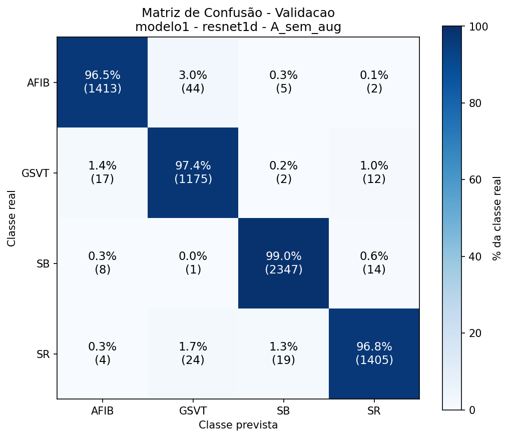
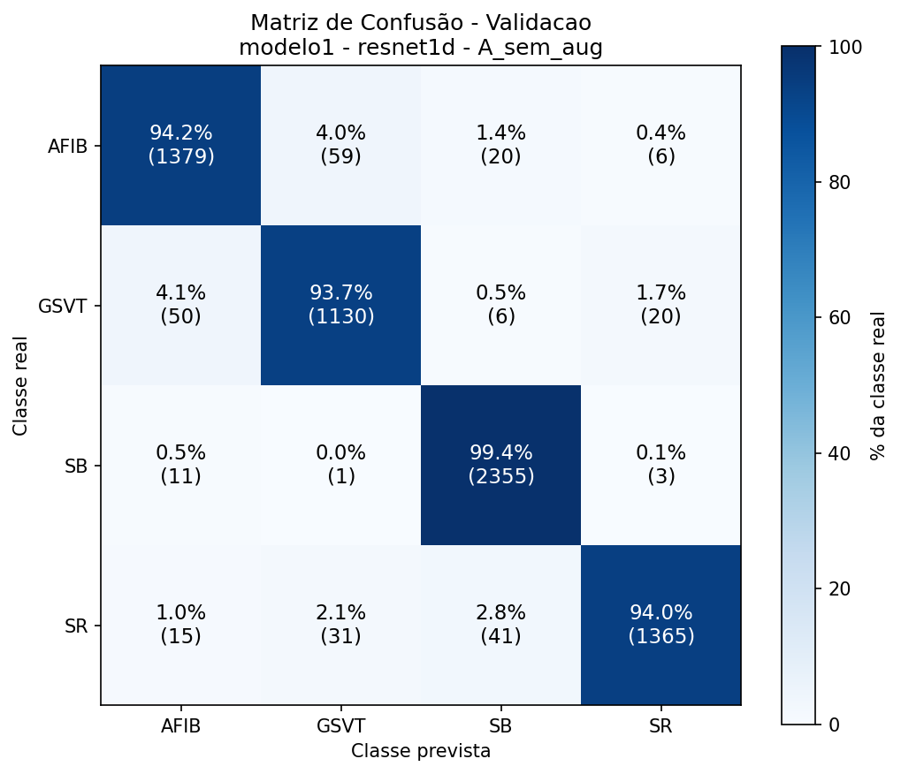
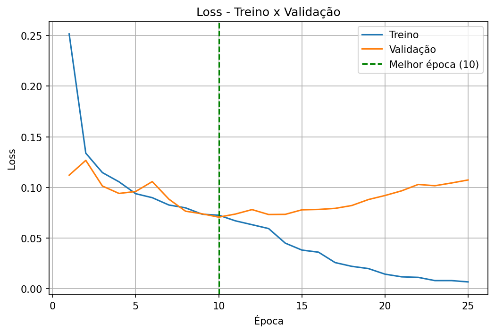
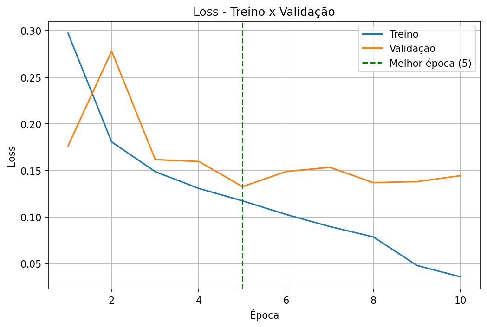
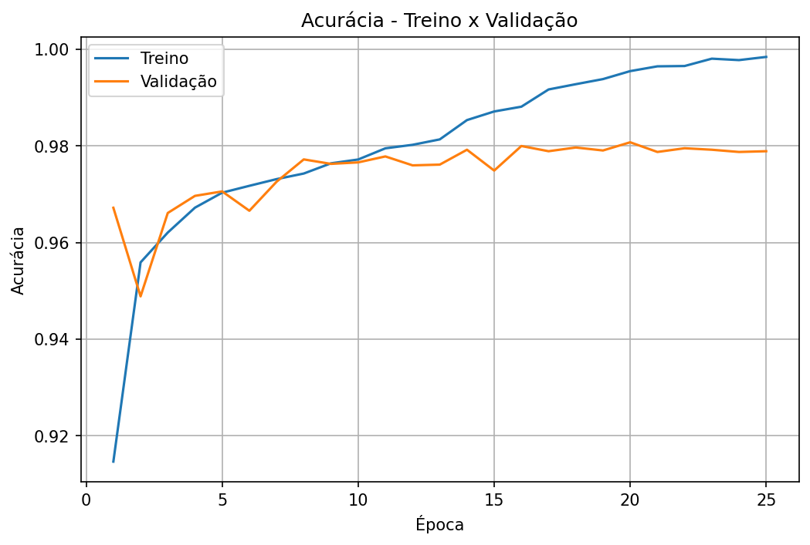
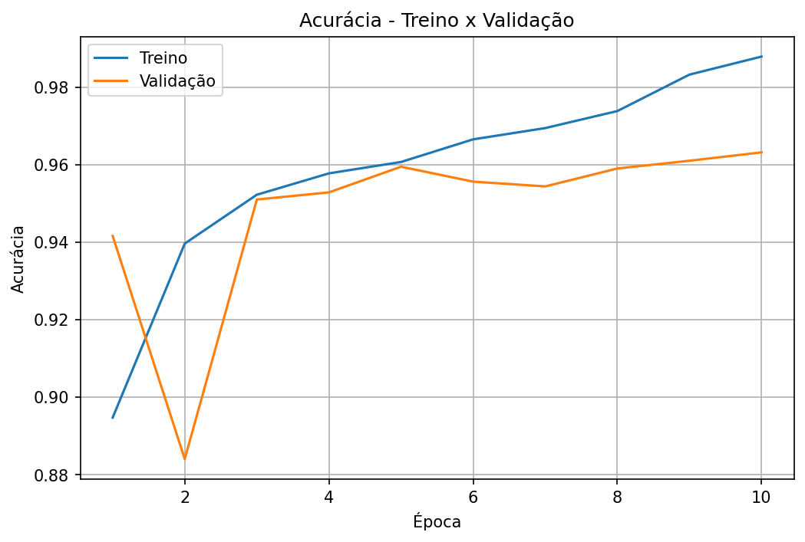
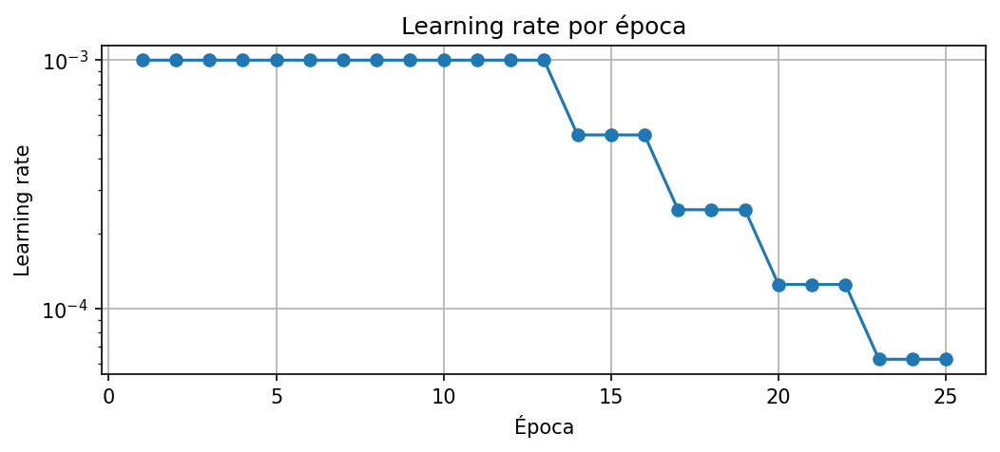
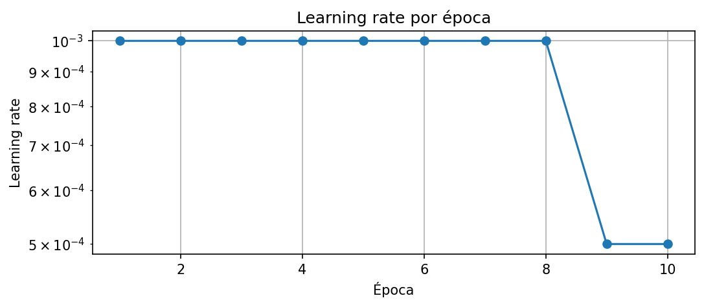

# Modelo 1: classificador geral (AFIB, GSVT, SB, SR)

Primeiro estágio da [cascata](../README.md). Classifica o ECG em 4 grupos de ritmo. Os grupos AFIB, GSVT e SR reúnem várias classes originais, que são refinadas pelos modelos 2, 3 e 4.

**Resultado: bom.** Com `earlystop15`, 98,01% de acurácia e F1 macro de 0,978 no teste. A configuração `descongelamento40` chega a 96,18%.

## Tarefa

| Classe | Classes originais agrupadas |
|---|---|
| AFIB | AFIB, AF |
| GSVT | SVT, AT, AVRT, ST |
| SB | SB |
| SR | SR, SA |

## Dados

| Classe | Treino | Validação | Teste | Peso na perda |
|---|---|---|---|---|
| AFIB | 6819 | 1464 | 1461 | 1,054 |
| GSVT | 5637 | 1206 | 1209 | 1,159 |
| SB | 11052 | 2370 | 2371 | 0,828 |
| SR | 6780 | 1452 | 1450 | 1,057 |
| **Total** | **30288** | **6492** | **6491** | |

Sem augmentation. Os pesos de classe (raiz inversa) ficam entre 0,83 e 1,16, ou seja, pouco mudam a perda, já que os grupos são relativamente equilibrados.

## Treino

ResNet1D treinada do zero, com perda ponderada e `ReduceLROnPlateau` (hiperparâmetros no [README geral](../README.md#configuração-de-treino)). Duas configurações:

- `earlystop15`: early stopping com paciência 15.
- `descongelamento40`: treino curto (paciência 5, inferida do número de épocas).

| | earlystop15 | descongelamento40 |
|---|---|---|
| Épocas executadas | 25 (early stopping) | 10 (early stopping) |
| Melhor época | 10 | 5 |
| Tempo | 59,65 min | 17,67 min |
| Acurácia de treino (melhor época) | 97,72% | 96,07% |
| Loss de treino / validação (melhor época) | 0,0725 / 0,0707 | 0,1175 / 0,1327 |
| Learning rate inicial → final | 0,001 → 6,25e-5 | 0,001 → 0,0005 |

## Resultados

### Resumo (teste)

| Configuração | Acurácia | Acc. balanceada | F1 macro | F1 ponderado | Baseline (sempre SB) |
|---|---|---|---|---|---|
| earlystop15 | 98,01% | 0,9780 | 0,9779 | 0,9801 | 36,5% |
| descongelamento40 | 96,18% | 0,9553 | 0,9570 | 0,9617 | 36,5% |

### Resumo (validação)

| Configuração | Acurácia | Acc. balanceada | F1 macro | F1 ponderado | Baseline (sempre SB) |
|---|---|---|---|---|---|
| earlystop15 | 97,66% | 0,9743 | 0,9738 | 0,9766 | 36,5% |
| descongelamento40 | 95,95% | 0,9532 | 0,9545 | 0,9594 | 36,5% |

### Por classe (teste)

| Classe | Exames | earlystop15: Precisão / Recall / F1 | descongelamento40: Precisão / Recall / F1 |
|---|---|---|---|
| AFIB | 1461 | 0,9910 / 0,9767 / **0,9838** | 0,9448 / 0,9493 / 0,9471 |
| GSVT | 1209 | 0,9569 / 0,9744 / **0,9656** | 0,9370 / 0,9355 / 0,9363 |
| SB | 2371 | 0,9895 / 0,9920 / **0,9907** | 0,9740 / 0,9962 / 0,9850 |
| SR | 1450 | 0,9737 / 0,9690 / **0,9713** | 0,9799 / 0,9400 / 0,9595 |

### Por classe (validação)

| Classe | Exames | earlystop15: Precisão / Recall / F1 | descongelamento40: Precisão / Recall / F1 |
|---|---|---|---|
| AFIB | 1464 | 0,9799 / 0,9652 / **0,9725** | 0,9478 / 0,9419 / 0,9448 |
| GSVT | 1206 | 0,9445 / 0,9743 / **0,9592** | 0,9255 / 0,9370 / 0,9312 |
| SB | 2370 | 0,9890 / 0,9903 / **0,9897** | 0,9723 / 0,9937 / 0,9829 |
| SR | 1452 | 0,9805 / 0,9676 / **0,9740** | 0,9792 / 0,9401 / 0,9592 |

### Matriz de confusão (teste)

Linhas = classe real, colunas = classe prevista. Contagem e % da classe real.

**earlystop15**

| Real \ Previsto | AFIB | GSVT | SB | SR |
|---|---|---|---|---|
| **AFIB** | 1427 (97,7%) | 31 (2,1%) | 1 (0,1%) | 2 (0,1%) |
| **GSVT** | 8 (0,7%) | 1178 (97,4%) | 3 (0,2%) | 20 (1,7%) |
| **SB** | 3 (0,1%) | 0 (0,0%) | 2352 (99,2%) | 16 (0,7%) |
| **SR** | 2 (0,1%) | 22 (1,5%) | 21 (1,4%) | 1405 (96,9%) |

**descongelamento40**

| Real \ Previsto | AFIB | GSVT | SB | SR |
|---|---|---|---|---|
| **AFIB** | 1387 (94,9%) | 44 (3,0%) | 19 (1,3%) | 11 (0,8%) |
| **GSVT** | 60 (5,0%) | 1131 (93,5%) | 4 (0,3%) | 14 (1,2%) |
| **SB** | 5 (0,2%) | 1 (0,0%) | 2362 (99,6%) | 3 (0,1%) |
| **SR** | 16 (1,1%) | 31 (2,1%) | 40 (2,8%) | 1363 (94,0%) |

| | earlystop15 | descongelamento40 |
|---|---|---|
| Teste |  |  |

### Matriz de confusão (validação)

Linhas = classe real, colunas = classe prevista. Contagem e % da classe real.

**earlystop15**

| Real \ Previsto | AFIB | GSVT | SB | SR |
|---|---|---|---|---|
| **AFIB** | 1413 (96,5%) | 44 (3,0%) | 5 (0,3%) | 2 (0,1%) |
| **GSVT** | 17 (1,4%) | 1175 (97,4%) | 2 (0,2%) | 12 (1,0%) |
| **SB** | 8 (0,3%) | 1 (0,0%) | 2347 (99,0%) | 14 (0,6%) |
| **SR** | 4 (0,3%) | 24 (1,7%) | 19 (1,3%) | 1405 (96,8%) |

**descongelamento40**

| Real \ Previsto | AFIB | GSVT | SB | SR |
|---|---|---|---|---|
| **AFIB** | 1379 (94,2%) | 59 (4,0%) | 20 (1,4%) | 6 (0,4%) |
| **GSVT** | 50 (4,1%) | 1130 (93,7%) | 6 (0,5%) | 20 (1,7%) |
| **SB** | 11 (0,5%) | 1 (0,0%) | 2355 (99,4%) | 3 (0,1%) |
| **SR** | 15 (1,0%) | 31 (2,1%) | 41 (2,8%) | 1365 (94,0%) |

| | earlystop15 | descongelamento40 |
|---|---|---|
| Validação |  |  |

## Curvas de treino

| | earlystop15 | descongelamento40 |
|---|---|---|
| Loss |  |  |
| Acurácia |  |  |
| Learning rate |  |  |

## Comparação com o experimento anterior

O experimento anterior usou perda sem pesos, LR fixo e paciência 5 (documentado no zip anterior). Resultados no teste:

| Configuração | Acurácia | Acc. balanceada | F1 macro | Recall AFIB | Recall GSVT | Recall SB | Recall SR | Melhor época |
|---|---|---|---|---|---|---|---|---|
| Experimento anterior (sem pesos, sem scheduler) | 97,86% | 0,9752 | 0,9763 | 0,9754 | 0,9702 | 0,9975 | 0,9579 | 18 de 23 |
| descongelamento40 | 96,18% | 0,9553 | 0,9570 | 0,9493 | 0,9355 | 0,9962 | 0,9400 | 5 de 10 |
| earlystop15 | 98,01% | 0,9780 | 0,9779 | 0,9767 | 0,9744 | 0,9920 | 0,9690 | 10 de 25 |

A acurácia balanceada do experimento anterior foi calculada como a média dos recalls por classe do teste (valores do README anterior).

## Análise

- **`earlystop15` é melhor que `descongelamento40` em todas as classes** (acurácia de teste 98,01% contra 96,18%; F1 macro 0,978 contra 0,957). O treino curto parou na época 10 (melhor época 5), com a loss de validação oscilando entre 0,133 e 0,154 e o LR reduzido uma única vez (época 9).
- **Diferença para o experimento anterior é pequena.** O experimento anterior (sem pesos e sem scheduler) teve 97,86% e F1 macro 0,9763; agora 98,01% e 0,9779. A diferença de 0,15 ponto percentual equivale a cerca de 10 exames em 6491, o que não permite concluir que pesos ou scheduler ajudaram neste modelo (uma execução por configuração).
- **O sobreajuste aparece na loss, não na acurácia.** Em `earlystop15`, a loss de treino cai de 0,0725 (melhor época) para 0,0067 (época 25) e a de validação sobe de 0,0707 para 0,1074. A acurácia de validação, porém, fica estável entre 0,975 e 0,981 (máximo de 0,9807 na época 20, contra 0,9766 na época escolhida). Ou seja, a rede fica mais confiante nos erros sem piorar a taxa de acertos. Escolher a época pela loss é conservador, e o resultado de teste (98,01%) confirma que a escolha foi razoável.
- **Principais confusões no teste (`earlystop15`):** AFIB → GSVT (31 exames, 2,1%), SR → GSVT (22), SR → SB (21), GSVT → SR (20) e SB → SR (16). Cada erro desses encaminha o exame ao especialista errado na cascata.
- **`descongelamento40` tinha um viés claro:** 60 GSVT previstos como AFIB (5,0%), contra 8 em `earlystop15`.
- **SB é a classe mais fácil** (recall 99,2% e precisão 98,9% em `earlystop15`). SR tem o menor recall (96,9%). O grupo SR inclui SA, que é difícil de reconhecer (modelo 4); parte desses erros pode vir de SA, mas isso não é medido aqui, porque a matriz é por grupo e não por classe original.
- **Instabilidade nas primeiras épocas:** a acurácia de validação cai para 0,949 na época 2 (`earlystop15`) e 0,884 (`descongelamento40`), enquanto o LR ainda é 1e-3. Depois estabiliza.

## Hipóteses e próximos passos

1. **Avaliar por classe original.** Medir quantos SA e quantos AF/AFIB o modelo 1 envia ao grupo errado, usando os rótulos de 9 classes.
2. **Escolher a época por F1 macro ou acurácia balanceada**, não só pela loss, e comparar com a escolha atual.
3. **Reduzir o LR inicial** (por exemplo 3e-4) ou usar warmup, para evitar as quedas das primeiras épocas.
4. **Repetir com outras sementes** para saber se a diferença de 0,15 ponto contra o experimento anterior existe.

## Arquivos gerados

`sinais_ecg_4c_modelo1_resnet1d_A_sem_aug_pesos-raiz_inversa_lrsched_<config>`, com `<config>` = `earlystop15` ou `descongelamento40`: `.json` (métricas e histórico), `.pt` (pesos), `_loss.png`, `_acuracia.png`, `_lr.png`, `_matriz_validacao.png`, `_matriz_teste.png`. Neste repositório, as figuras estão em `earlystop15/` e `descongelamento40/`.
