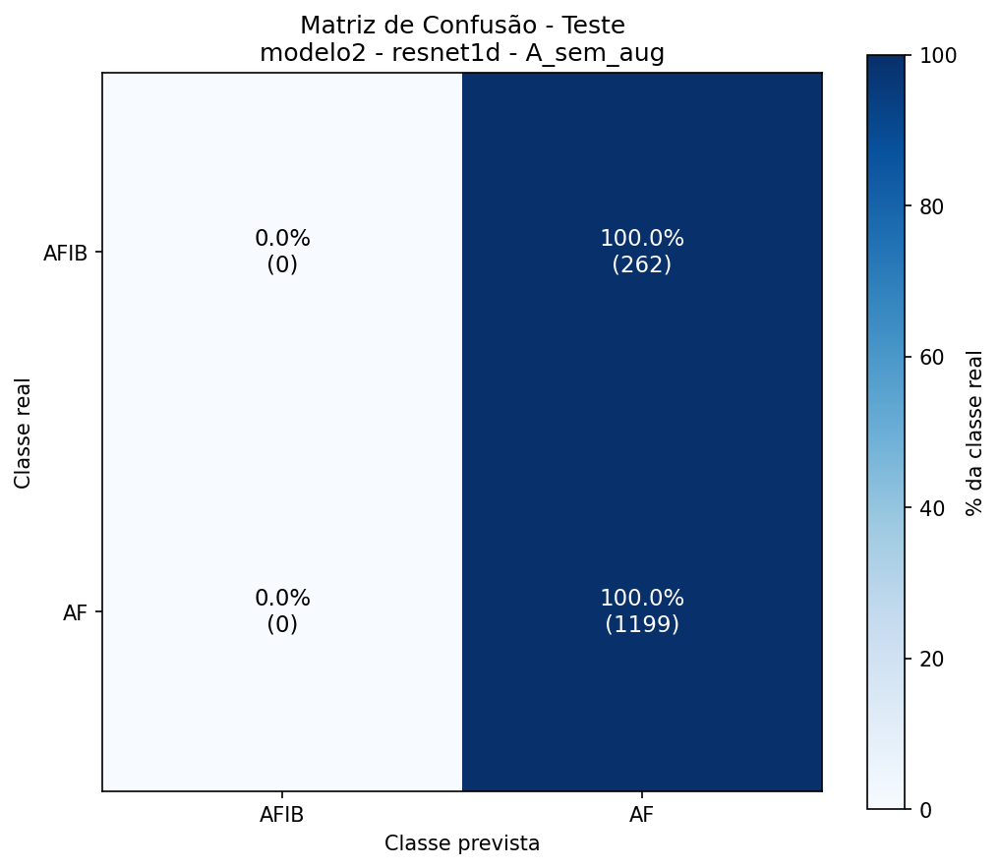
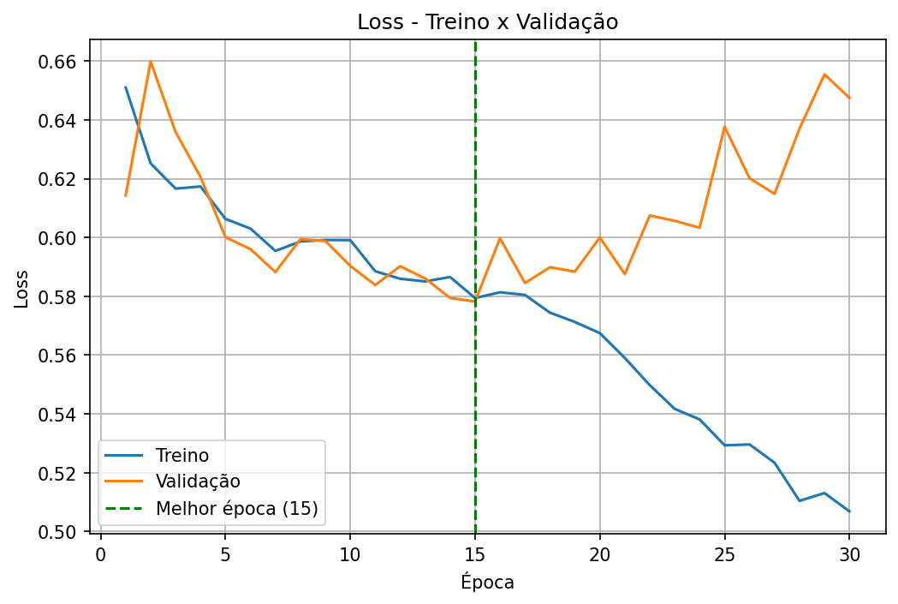
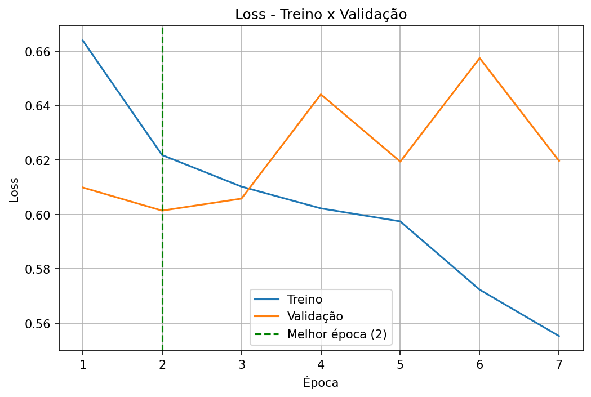
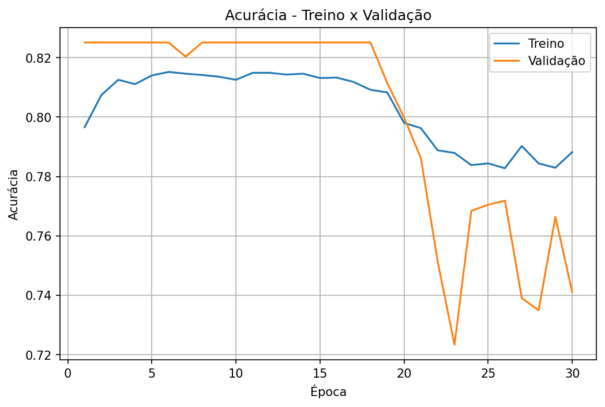
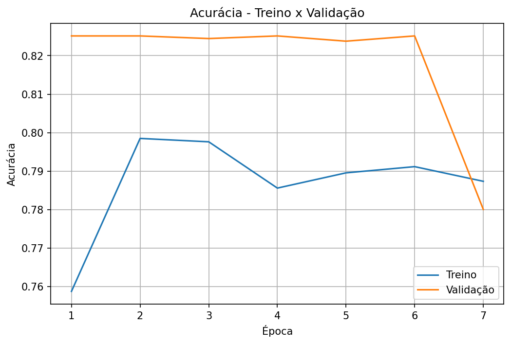
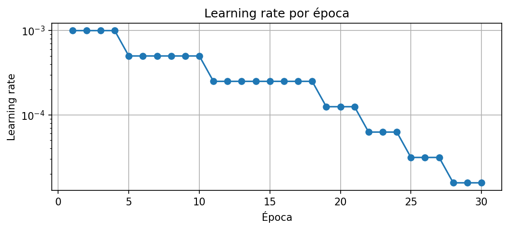
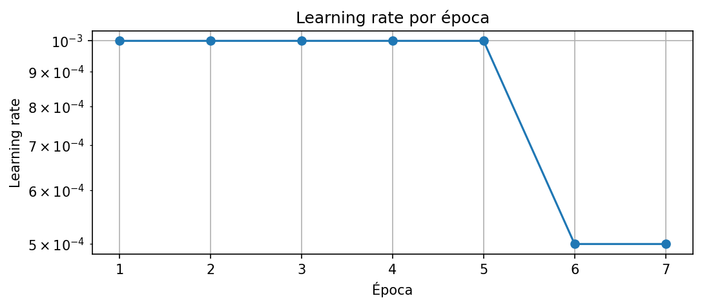

# Modelo 2: especialista do grupo AFIB (AFIB × AF)

Segundo estágio da [cascata](../README.md). Deveria distinguir fibrilação atrial (AFIB) de flutter atrial (AF) nos exames que o [modelo 1](../modelo1/README.md) classifica como AFIB.

**Resultado: o modelo não aprendeu a tarefa.** Na configuração `descongelamento40` ele prevê AF para todos os exames, e a acurácia é igual à de um classificador que sempre responde a classe majoritária (a mesma situação do experimento anterior). A configuração `earlystop15` só tem as curvas, sem JSON nem matrizes de confusão; pelas curvas, o resultado provavelmente é o mesmo. Não deve ser usado na cascata como está.

## Tarefa

Classificação binária, usando só os exames das classes AFIB e AF.

## Dados

| Classe | Treino | Validação | Teste | Peso na perda |
|---|---|---|---|---|
| AFIB | 1262 | 256 | 262 | 1,644 |
| AF | 5557 | 1208 | 1199 | 0,783 |
| **Total** | **6819** | **1464** | **1461** | |

Desbalanceamento de cerca de 4,4 para 1 (AF é 81,5% do treino). Sem augmentation. Os pesos de classe (1,644 para AFIB e 0,783 para AF) compensam só parte do desbalanceamento.

## Treino

ResNet1D treinada do zero, com perda ponderada e `ReduceLROnPlateau` (hiperparâmetros no [README geral](../README.md#configuração-de-treino)). Duas configurações:

- `earlystop15`: early stopping com paciência 15.
- `descongelamento40`: treino curto (paciência 5, inferida do número de épocas).

| | descongelamento40 |
|---|---|
| Épocas executadas | 7 (early stopping) |
| Melhor época | 2 |
| Tempo | 2,89 min |
| Acurácia de treino (melhor época) | 79,85% |
| Loss de treino / validação (melhor época) | 0,6218 / 0,6014 |
| Learning rate inicial → final | 0,001 → 0,0005 |

**Configuração `earlystop15`: só curvas.** Executou 30 épocas, com melhor época 15 (valores lidos dos gráficos; LR final ≈ 1,6e-5). O JSON e as matrizes dessa execução não foram enviados.

## Resultados

### Resumo (teste)

| Configuração | Acurácia | Acc. balanceada | F1 macro | F1 ponderado | Baseline (sempre AF) |
|---|---|---|---|---|---|
| descongelamento40 | 82,07% | 0,5000 | 0,4508 | 0,7398 | 82,1% |

### Resumo (validação)

| Configuração | Acurácia | Acc. balanceada | F1 macro | F1 ponderado | Baseline (sempre AF) |
|---|---|---|---|---|---|
| descongelamento40 | 82,51% | 0,5000 | 0,4521 | 0,7461 | 82,5% |

### Por classe (teste)

| Classe | Exames | descongelamento40: Precisão / Recall / F1 |
|---|---|---|
| AFIB | 262 | 0,0000 / 0,0000 / 0,0000 |
| AF | 1199 | 0,8207 / 1,0000 / 0,9015 |

### Por classe (validação)

| Classe | Exames | descongelamento40: Precisão / Recall / F1 |
|---|---|---|
| AFIB | 256 | 0,0000 / 0,0000 / 0,0000 |
| AF | 1208 | 0,8251 / 1,0000 / 0,9042 |

### Matriz de confusão (teste)

Linhas = classe real, colunas = classe prevista. Contagem e % da classe real.

**descongelamento40**

| Real \ Previsto | AFIB | AF |
|---|---|---|
| **AFIB** | 0 (0,0%) | 262 (100,0%) |
| **AF** | 0 (0,0%) | 1199 (100,0%) |

| | earlystop15 | descongelamento40 |
|---|---|---|
| Teste | _não disponível_ |  |

### Matriz de confusão (validação)

Linhas = classe real, colunas = classe prevista. Contagem e % da classe real.

**descongelamento40**

| Real \ Previsto | AFIB | AF |
|---|---|---|
| **AFIB** | 0 (0,0%) | 256 (100,0%) |
| **AF** | 0 (0,0%) | 1208 (100,0%) |

| | earlystop15 | descongelamento40 |
|---|---|---|
| Validação | _não disponível_ |  |

## Curvas de treino

| | earlystop15 | descongelamento40 |
|---|---|---|
| Loss |  |  |
| Acurácia |  |  |
| Learning rate |  |  |

## Comparação com o experimento anterior

O experimento anterior usou perda sem pesos, LR fixo e paciência 5 (documentado no zip anterior). Resultados no teste:

| Configuração | Acurácia | Acc. balanceada | F1 macro | Recall AFIB | Recall AF | Melhor época |
|---|---|---|---|---|---|---|
| Experimento anterior (sem pesos, sem scheduler) | 82,07% | 0,5000 | 0,4508 | 0,0000 | 1,0000 | 17 de 22 |
| descongelamento40 | 82,07% | 0,5000 | 0,4508 | 0,0000 | 1,0000 | 2 de 7 |

A acurácia balanceada do experimento anterior foi calculada como a média dos recalls por classe do teste (valores do README anterior).

## Análise

- **`descongelamento40`: colapso confirmado.** A matriz de confusão mostra 100% dos exames previstos como AF, no teste (262 AFIB e 1199 AF) e na validação. A acurácia de validação (0,8251) é exatamente a proporção de AF na validação (1208 de 1464). Recall de AFIB = 0 e acurácia balanceada = 0,5.
- **Os pesos de classe não resolveram o colapso.** O experimento anterior (sem pesos) também previa só AF (acurácia de teste 82,07%).
- **Na configuração `descongelamento40`, o modelo não prevê só AF no treino.** A acurácia de treino na melhor época (0,7985) é menor que a proporção de AF no treino (0,8149). Na validação, o modelo prevê só AF. Isso pode vir de probabilidades próximas do prior, com os pesos deslocando a fronteira de decisão, ou de diferença entre BatchNorm em treino e em avaliação. Nenhuma das duas causas foi verificada.
- **`earlystop15` (só curvas):** a acurácia de validação fica em ~0,825 (a proporção de AF) até a época 18, com uma única queda leve na época 7. A melhor época pela loss (15) está dentro desse trecho, então os pesos restaurados provavelmente ainda são o classificador trivial. **Isso é provável, não confirmado**; falta o JSON e as matrizes dessa execução.
- **Depois da época 18 a acurácia de validação cai** chega a 0,72 (época 23) e oscila entre 0,72 e 0,77 até o fim, e a de treino cai de ~0,81 para ~0,79, enquanto a loss de treino continua caindo (0,58 → 0,51). Esse padrão é compatível com o modelo passar a prever AFIB para parte dos exames, trocando acertos de AF por acertos de AFIB, o que é esperado com perda ponderada. Mas a loss de validação sobe (de 0,578 para ~0,65) no mesmo período, então não há época em que isso generalize.
- **Existe um sinal fraco, que a acurácia esconde.** Com a perda ponderada padrão do PyTorch (média ponderada), um preditor constante ótimo teria loss ≈ 0,629 com estes pesos. A loss de validação na melhor época é 0,601 (`descongelamento40`) e 0,578 (`earlystop15`, lido do gráfico), um pouco abaixo disso. Isso supõe que a loss de validação use os mesmos pesos, o que não está registrado. Se for o caso, o modelo ordena os exames um pouco melhor que o acaso, e uma métrica como AUC ou um limiar ajustado poderia mostrar isso.
- O modelo 1 reconhece o grupo AFIB com recall de 97,7% (`earlystop15`). A dificuldade está especificamente em separar AFIB de AF, e não em reconhecer o grupo.

## Hipóteses e próximos passos

Nenhuma das hipóteses abaixo foi testada ainda. Duas do experimento anterior já foram testadas: pesos de classe (não resolveram) e scheduler com paciência maior (as curvas de `earlystop15` ainda mostram o platô até a época 18).

1. **Gerar o JSON e as matrizes de `earlystop15`** para confirmar o que as curvas sugerem.
2. **Medir AUC, curva precisão × recall de AFIB e acurácia balanceada** por época, e escolher a época por uma delas (a loss escolhe uma época em que a acurácia ainda é a trivial).
3. **Ajustar o limiar de decisão** em vez de usar o argmax.
4. **Amostragem balanceada ou subamostragem de AF**, em vez de pesos na perda.
5. **LR inicial menor** (por exemplo 1e-4).
6. **Qualidade dos rótulos:** AFIB e AF podem coexistir ou ser difíceis de rotular. Revisar uma amostra e checar duplicatas entre treino e teste.

## Arquivos gerados

`sinais_ecg_4c_modelo2_resnet1d_A_sem_aug_pesos-raiz_inversa_lrsched_<config>`, com `<config>` = `earlystop15` ou `descongelamento40`: `.json` (métricas e histórico), `.pt` (pesos), `_loss.png`, `_acuracia.png`, `_lr.png`, `_matriz_validacao.png`, `_matriz_teste.png`. Neste repositório, as figuras estão em `earlystop15/` e `descongelamento40/`.
