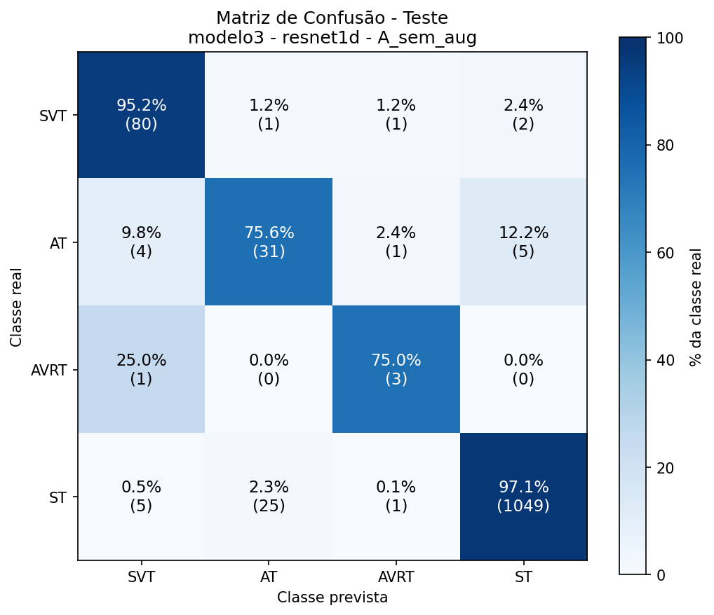
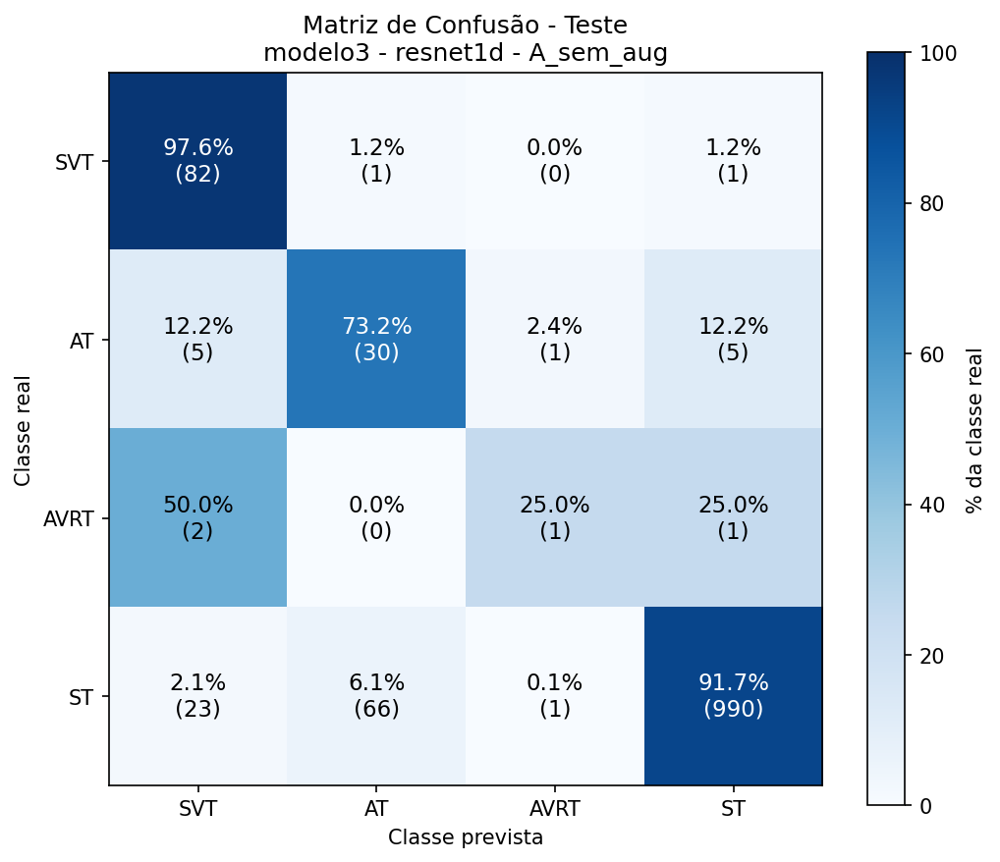
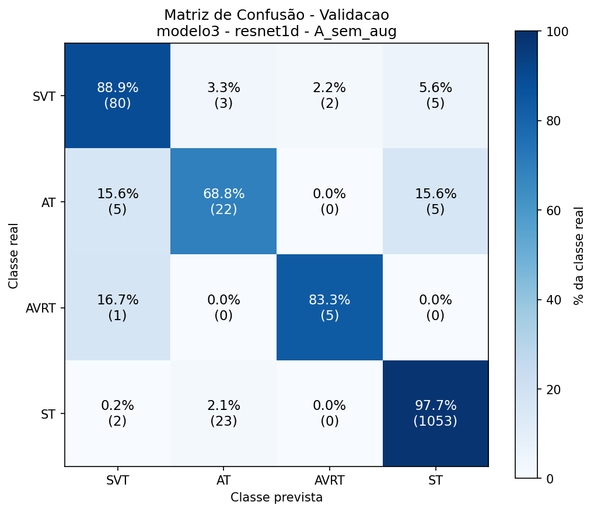
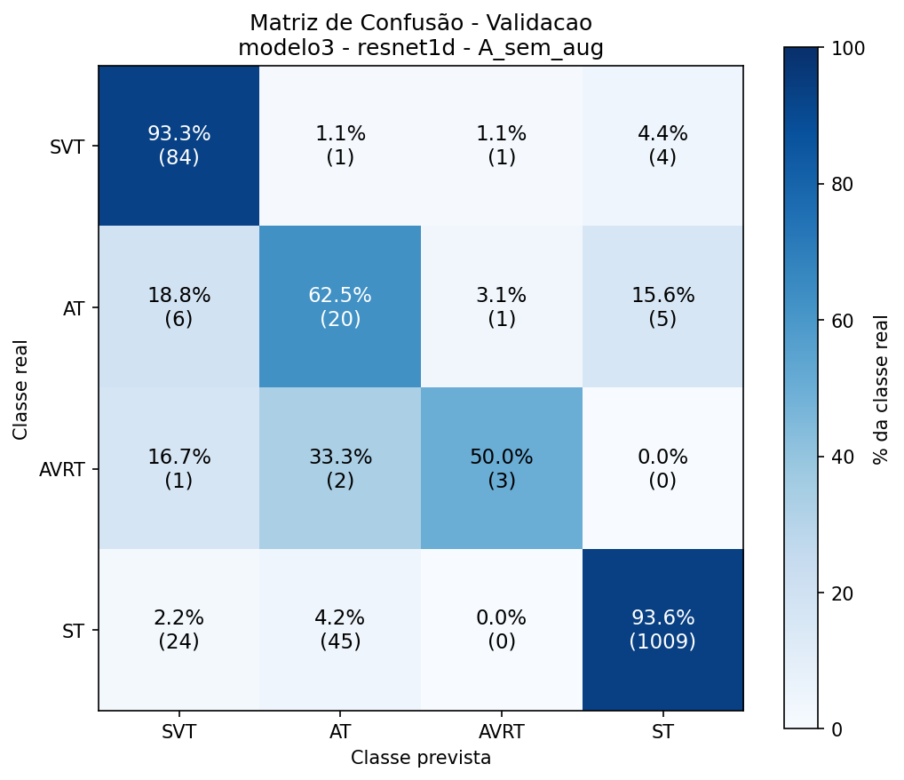
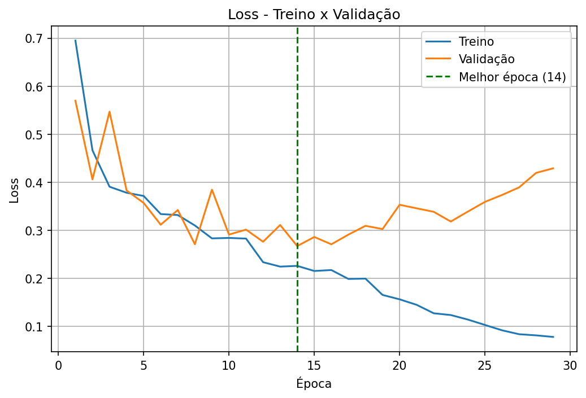
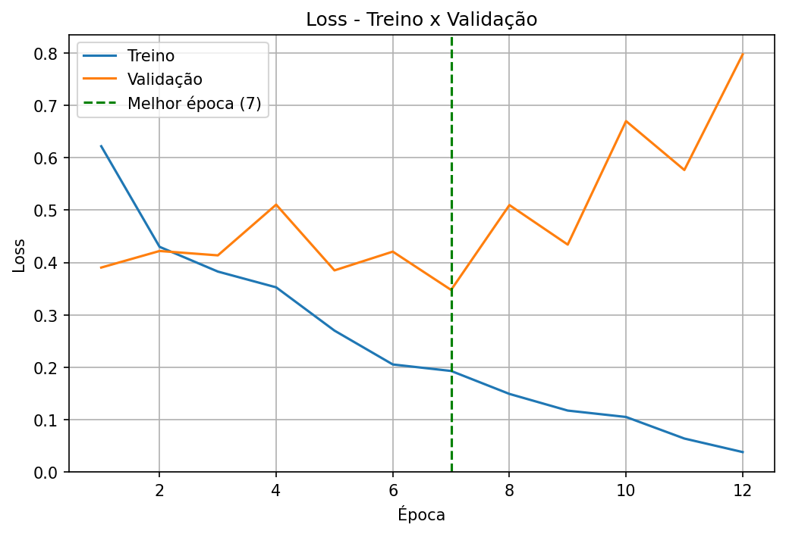
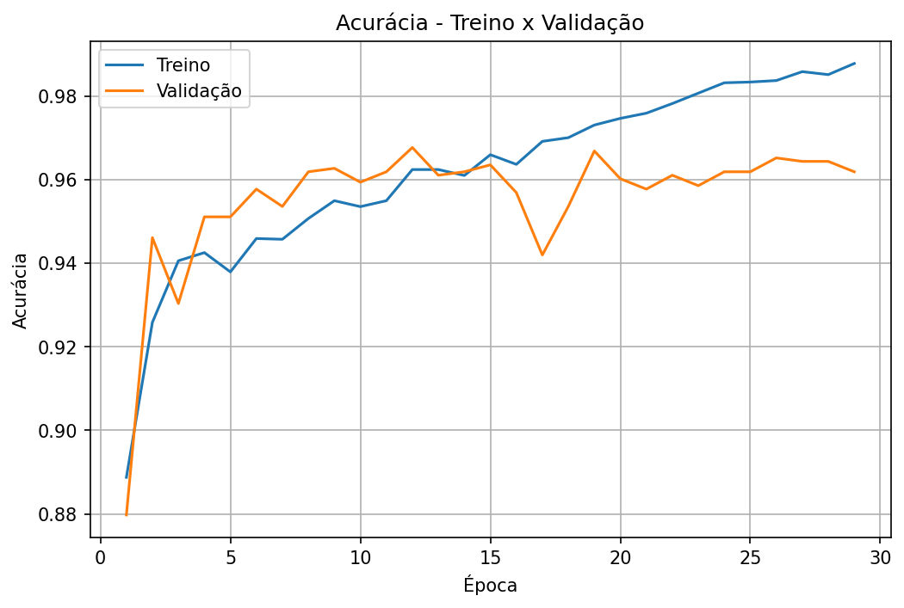
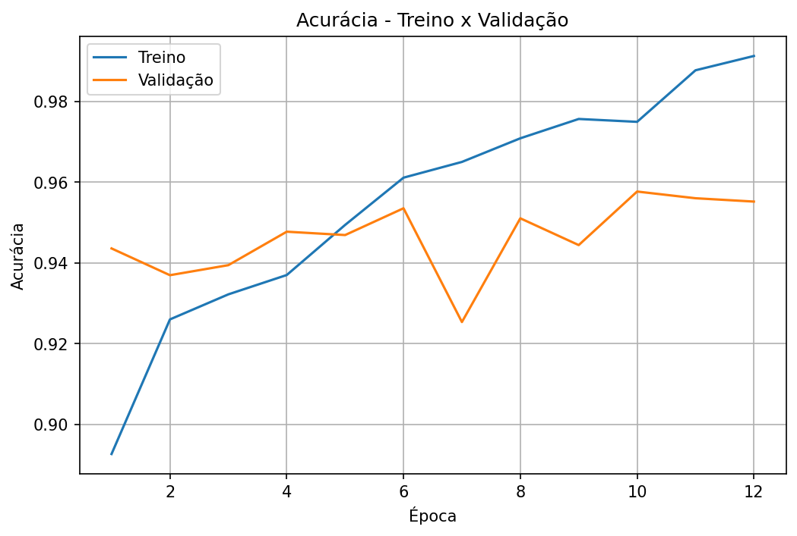
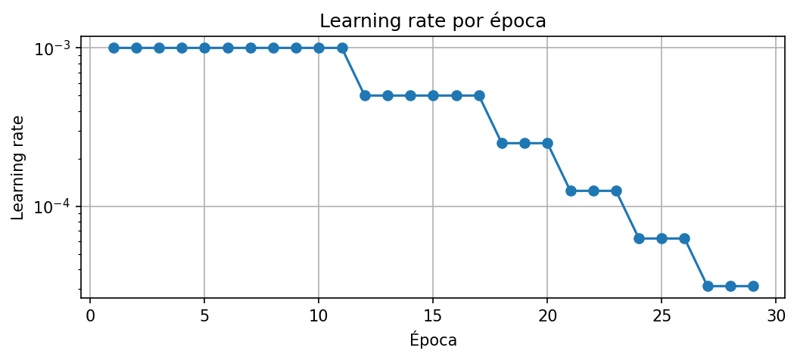
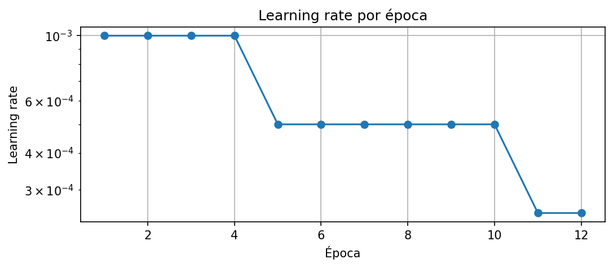

# Modelo 3: especialista do grupo GSVT (SVT, AT, AVRT, ST)

Terceiro estágio da [cascata](../README.md). Distingue as quatro classes originais do grupo GSVT nos exames que o [modelo 1](../modelo1/README.md) classifica como GSVT.

**Resultado: parcial, melhor que no experimento anterior.** Com `earlystop15`, a acurácia balanceada vai de 0,62 para 0,86 e o F1 macro de 0,67 para 0,78, porque AT e AVRT passam a ser reconhecidos. O custo são mais falsos positivos de AT vindos de ST. AVRT tem 4 exames de teste, então o resultado dessa classe é pouco confiável.

## Tarefa

Classificação em 4 classes, usando só os exames de SVT, AT, AVRT e ST.

## Dados

| Classe | Treino | Validação | Teste | Peso na perda |
|---|---|---|---|---|
| SVT | 486 | 90 | 84 | 1,703 |
| AT | 177 | 32 | 41 | 2,822 |
| AVRT | 14 | 6 | 4 | 10,033 |
| ST | 4960 | 1078 | 1080 | 0,533 |
| **Total** | **5637** | **1206** | **1209** | |

Desbalanceamento extremo: ST é 88% do treino e AVRT tem apenas 14 exames. Sem augmentation. Os pesos de classe vão de 0,533 (ST) a 10,033 (AVRT).

## Treino

ResNet1D treinada do zero, com perda ponderada e `ReduceLROnPlateau` (hiperparâmetros no [README geral](../README.md#configuração-de-treino)). Duas configurações:

- `earlystop15`: early stopping com paciência 15.
- `descongelamento40`: treino curto (paciência 5, inferida do número de épocas).

| | earlystop15 | descongelamento40 |
|---|---|---|
| Épocas executadas | 29 (early stopping) | 12 (early stopping) |
| Melhor época | 14 | 7 |
| Tempo | 13,04 min | 4,07 min |
| Acurácia de treino (melhor época) | 96,10% | 96,51% |
| Loss de treino / validação (melhor época) | 0,2255 / 0,2668 | 0,1928 / 0,3476 |
| Learning rate inicial → final | 0,001 → 3,125e-5 | 0,001 → 0,00025 |

## Resultados

### Resumo (teste)

| Configuração | Acurácia | Acc. balanceada | F1 macro | F1 ponderado | Baseline (sempre ST) |
|---|---|---|---|---|---|
| earlystop15 | 96,20% | 0,8574 | 0,7836 | 0,9647 | 89,3% |
| descongelamento40 | 91,23% | 0,7186 | 0,6276 | 0,9254 | 89,3% |

### Resumo (validação)

| Configuração | Acurácia | Acc. balanceada | F1 macro | F1 ponderado | Baseline (sempre ST) |
|---|---|---|---|---|---|
| earlystop15 | 96,19% | 0,8466 | 0,8004 | 0,9648 | 89,4% |
| descongelamento40 | 92,54% | 0,7486 | 0,6819 | 0,9351 | 89,4% |

### Por classe (teste)

| Classe | Exames | earlystop15: Precisão / Recall / F1 | descongelamento40: Precisão / Recall / F1 |
|---|---|---|---|
| SVT | 84 | 0,8889 / 0,9524 / **0,9195** | 0,7321 / 0,9762 / 0,8367 |
| AT | 41 | 0,5439 / 0,7561 / **0,6327** | 0,3093 / 0,7317 / 0,4348 |
| AVRT | 4 | 0,5000 / 0,7500 / **0,6000** | 0,3333 / 0,2500 / 0,2857 |
| ST | 1080 | 0,9934 / 0,9713 / **0,9822** | 0,9930 / 0,9167 / 0,9533 |

### Por classe (validação)

| Classe | Exames | earlystop15: Precisão / Recall / F1 | descongelamento40: Precisão / Recall / F1 |
|---|---|---|---|
| SVT | 90 | 0,9091 / 0,8889 / **0,8989** | 0,7304 / 0,9333 / 0,8195 |
| AT | 32 | 0,4583 / 0,6875 / **0,5500** | 0,2941 / 0,6250 / 0,4000 |
| AVRT | 6 | 0,7143 / 0,8333 / **0,7692** | 0,6000 / 0,5000 / 0,5455 |
| ST | 1078 | 0,9906 / 0,9768 / **0,9837** | 0,9912 / 0,9360 / 0,9628 |

### Matriz de confusão (teste)

Linhas = classe real, colunas = classe prevista. Contagem e % da classe real.

**earlystop15**

| Real \ Previsto | SVT | AT | AVRT | ST |
|---|---|---|---|---|
| **SVT** | 80 (95,2%) | 1 (1,2%) | 1 (1,2%) | 2 (2,4%) |
| **AT** | 4 (9,8%) | 31 (75,6%) | 1 (2,4%) | 5 (12,2%) |
| **AVRT** | 1 (25,0%) | 0 (0,0%) | 3 (75,0%) | 0 (0,0%) |
| **ST** | 5 (0,5%) | 25 (2,3%) | 1 (0,1%) | 1049 (97,1%) |

**descongelamento40**

| Real \ Previsto | SVT | AT | AVRT | ST |
|---|---|---|---|---|
| **SVT** | 82 (97,6%) | 1 (1,2%) | 0 (0,0%) | 1 (1,2%) |
| **AT** | 5 (12,2%) | 30 (73,2%) | 1 (2,4%) | 5 (12,2%) |
| **AVRT** | 2 (50,0%) | 0 (0,0%) | 1 (25,0%) | 1 (25,0%) |
| **ST** | 23 (2,1%) | 66 (6,1%) | 1 (0,1%) | 990 (91,7%) |

| | earlystop15 | descongelamento40 |
|---|---|---|
| Teste |  |  |

### Matriz de confusão (validação)

Linhas = classe real, colunas = classe prevista. Contagem e % da classe real.

**earlystop15**

| Real \ Previsto | SVT | AT | AVRT | ST |
|---|---|---|---|---|
| **SVT** | 80 (88,9%) | 3 (3,3%) | 2 (2,2%) | 5 (5,6%) |
| **AT** | 5 (15,6%) | 22 (68,8%) | 0 (0,0%) | 5 (15,6%) |
| **AVRT** | 1 (16,7%) | 0 (0,0%) | 5 (83,3%) | 0 (0,0%) |
| **ST** | 2 (0,2%) | 23 (2,1%) | 0 (0,0%) | 1053 (97,7%) |

**descongelamento40**

| Real \ Previsto | SVT | AT | AVRT | ST |
|---|---|---|---|---|
| **SVT** | 84 (93,3%) | 1 (1,1%) | 1 (1,1%) | 4 (4,4%) |
| **AT** | 6 (18,8%) | 20 (62,5%) | 1 (3,1%) | 5 (15,6%) |
| **AVRT** | 1 (16,7%) | 2 (33,3%) | 3 (50,0%) | 0 (0,0%) |
| **ST** | 24 (2,2%) | 45 (4,2%) | 0 (0,0%) | 1009 (93,6%) |

| | earlystop15 | descongelamento40 |
|---|---|---|
| Validação |  |  |

## Curvas de treino

| | earlystop15 | descongelamento40 |
|---|---|---|
| Loss |  |  |
| Acurácia |  |  |
| Learning rate |  |  |

## Comparação com o experimento anterior

O experimento anterior usou perda sem pesos, LR fixo e paciência 5 (documentado no zip anterior). Resultados no teste:

| Configuração | Acurácia | Acc. balanceada | F1 macro | Recall SVT | Recall AT | Recall AVRT | Recall ST | Melhor época |
|---|---|---|---|---|---|---|---|---|
| Experimento anterior (sem pesos, sem scheduler) | 96,28% | 0,6213 | 0,6667 | 0,9762 | 0,2683 | 0,2500 | 0,9907 | 8 de 13 |
| descongelamento40 | 91,23% | 0,7186 | 0,6276 | 0,9762 | 0,7317 | 0,2500 | 0,9167 | 7 de 12 |
| earlystop15 | 96,20% | 0,8574 | 0,7836 | 0,9524 | 0,7561 | 0,7500 | 0,9713 | 14 de 29 |

A acurácia balanceada do experimento anterior foi calculada como a média dos recalls por classe do teste (valores do README anterior).

## Análise

- **A acurácia engana.** ST é 89,3% do teste, então um classificador que sempre responde ST acerta 89,3%. A acurácia de `earlystop15` (96,20%) é praticamente igual à do experimento anterior (96,28%), mas a acurácia balanceada passou de 0,62 para 0,86.
- **Os pesos de classe mudaram o equilíbrio entre as classes.** O recall de AT subiu de 0,27 para 0,76 (31 de 41) e o de AVRT de 0,25 para 0,75 (3 de 4). O custo: o recall de ST caiu de 0,991 para 0,971 e **25 ST foram classificados como AT** (contra 3 no experimento anterior). Como ST tem 1080 exames, esse erro pequeno em proporção derruba a precisão de AT para 0,544.
- **AVRT não pode ser avaliado com confiança.** São 14 exames de treino, 6 de validação e 4 de teste. O recall de 0,75 é 3 acertos em 4; o intervalo de confiança de 95% (Wilson) vai de 0,30 a 0,95. Na validação foram 5 acertos em 6 (0,44 a 0,97). Para AT (31 de 41) o intervalo é de 0,61 a 0,86.
- **`descongelamento40` é bem pior** (acurácia balanceada 0,72, F1 macro 0,63): 66 ST foram classificados como AT (6,1% de ST) e AVRT teve 1 acerto em 4.
- **A época escolhida pela loss em `descongelamento40` não é a melhor em acurácia.** A melhor época foi a 7, em que a acurácia de validação é a menor do treino (0,9254); na época 10 ela chega a 0,9577. Com os pesos, a loss de validação é dominada pelos erros em AVRT (peso 10, 6 exames) e AT (peso 2,8, 32 exames), o que a torna ruidosa como critério de escolha. Esta é uma hipótese; não foi testada.
- **Em `earlystop15`, o sobreajuste aparece na loss** (treino 0,078 e validação 0,429 na última época), enquanto a acurácia de validação fica em torno de 0,96.
- **SVT e ST estão bem resolvidos** (F1 de 0,92 e 0,98 no teste em `earlystop15`).
- **Instabilidade:** a acurácia de validação oscila ao longo do treino (0,880 na época 1, 0,930 na época 3 e 0,942 na época 17, entre valores próximos de 0,96).

## Hipóteses e próximos passos

Pesos de classe, uma das hipóteses do experimento anterior, já foram testados: melhoraram AT e AVRT, com mais falsos positivos de AT. As demais seguem sem teste.

1. **Augmentation** (ruído, deslocamento, escala de amplitude) só nas classes minoritárias, em vez de pesos tão altos.
2. **Mais dados de AVRT.** Com 14 exemplos, uma rede com milhões de parâmetros dificilmente generaliza. Considerar fundir AVRT com SVT ou tratá-la como "outras taquicardias supraventriculares".
3. **Escolher a época e o limiar por F1 macro ou acurácia balanceada**, para reduzir os falsos positivos de AT sem perder o recall.
4. **Reportar intervalos de confiança ou validação cruzada** para AT e AVRT.
5. **Testar pesos menos agressivos** (por exemplo, teto menor que 10 para AVRT).

## Arquivos gerados

`sinais_ecg_4c_modelo3_resnet1d_A_sem_aug_pesos-raiz_inversa_lrsched_<config>`, com `<config>` = `earlystop15` ou `descongelamento40`: `.json` (métricas e histórico), `.pt` (pesos), `_loss.png`, `_acuracia.png`, `_lr.png`, `_matriz_validacao.png`, `_matriz_teste.png`. Neste repositório, as figuras estão em `earlystop15/` e `descongelamento40/`.
