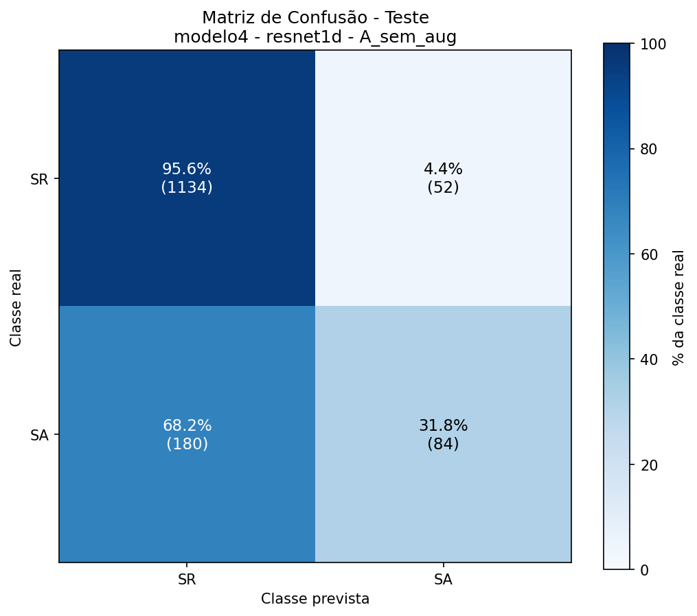
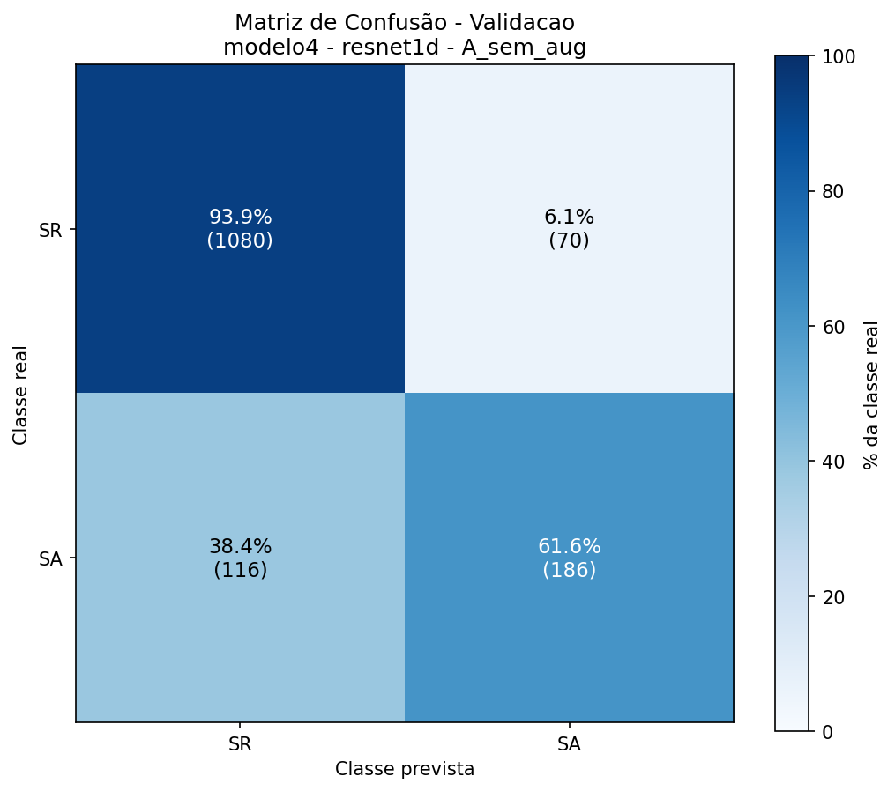
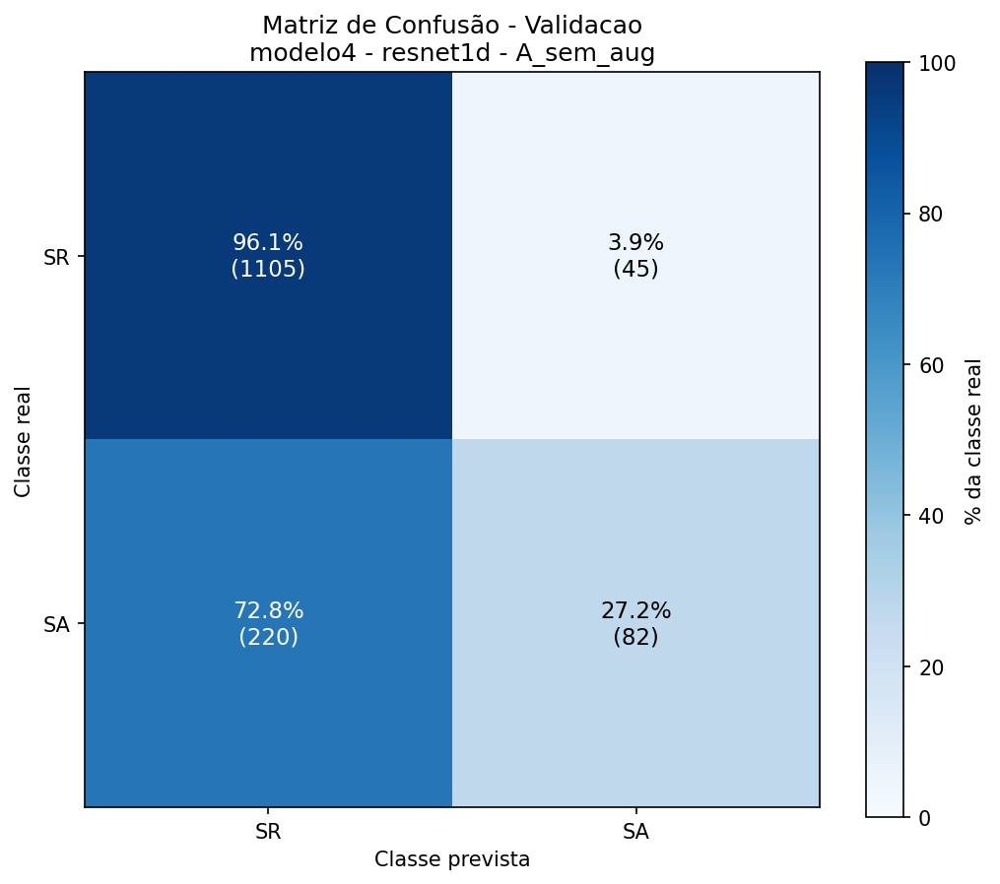
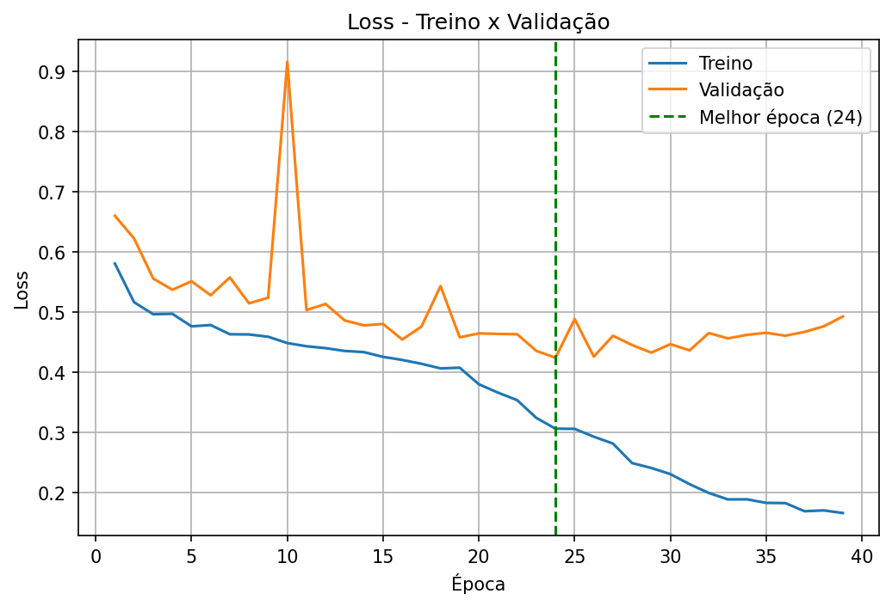
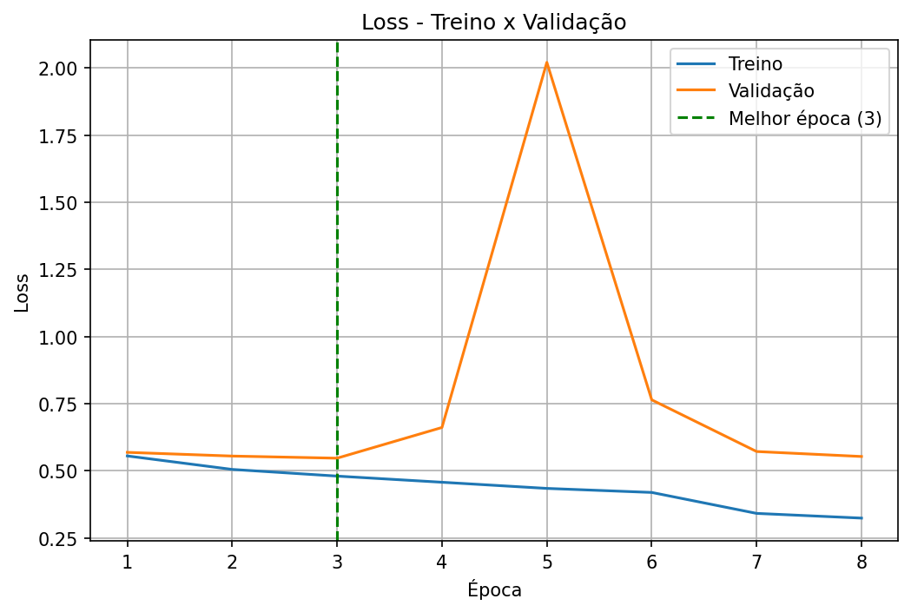
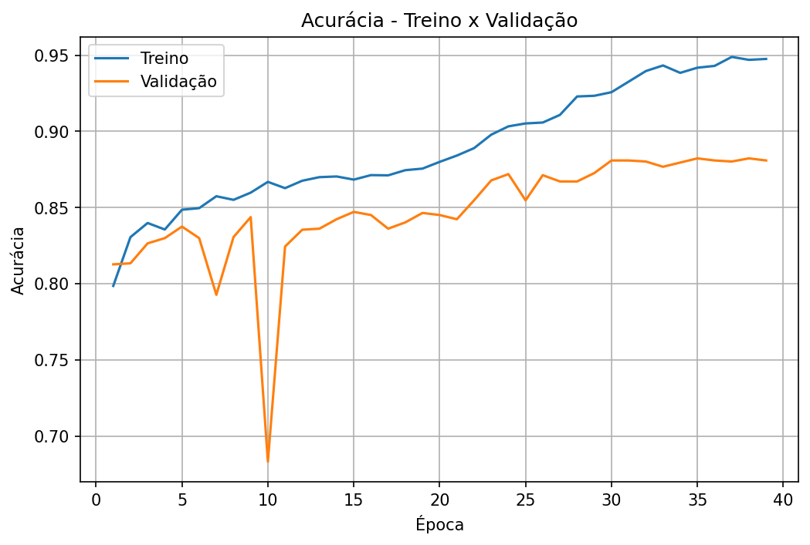
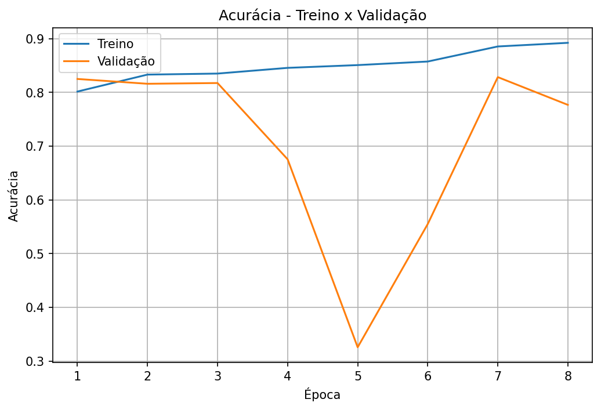
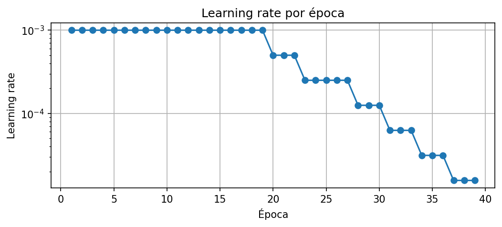
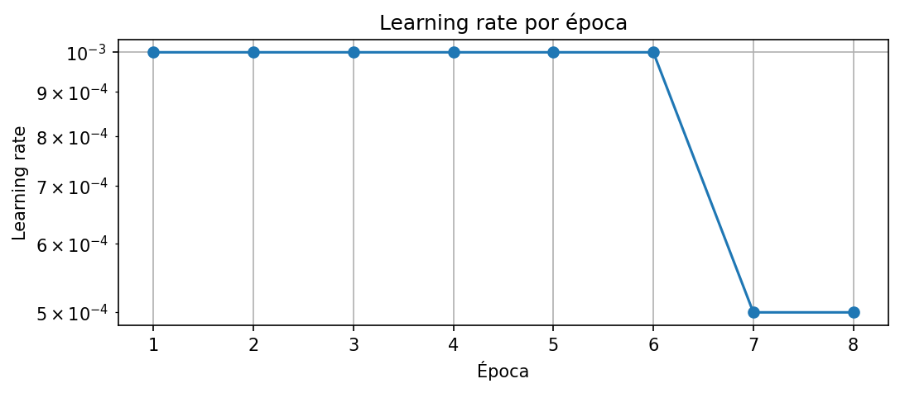

# Modelo 4: especialista do grupo SR (SR × SA)

Quarto estágio da [cascata](../README.md). No agrupamento usado pelo [modelo 1](../modelo1/README.md), o SA pertence ao grupo SR; este modelo distingue SR de SA nos exames classificados como SR.

**Resultado: parcial, melhor que no experimento anterior.** Com `earlystop15`, o recall de SA sobe de 0,28 para 0,60 e o F1 macro de 0,669 para 0,772. Ainda assim, 40% dos SA são previstos como SR e 7% dos SR como SA.

## Tarefa

Classificação binária, usando só os exames das classes SR e SA.

## Dados

| Classe | Treino | Validação | Teste | Peso na perda |
|---|---|---|---|---|
| SR | 5536 | 1150 | 1186 | 0,783 |
| SA | 1244 | 302 | 264 | 1,651 |
| **Total** | **6780** | **1452** | **1450** | |

Desbalanceamento de cerca de 4,5 para 1 (SR é 81,7% do treino). Sem augmentation. Pesos de classe: 0,783 (SR) e 1,651 (SA).

## Treino

ResNet1D treinada do zero, com perda ponderada e `ReduceLROnPlateau` (hiperparâmetros no [README geral](../README.md#configuração-de-treino)). Duas configurações:

- `earlystop15`: early stopping com paciência 15.
- `descongelamento40`: treino curto (paciência 5, inferida do número de épocas).

| | earlystop15 | descongelamento40 |
|---|---|---|
| Épocas executadas | 39 (early stopping) | 8 (early stopping) |
| Melhor época | 24 | 3 |
| Tempo | 21,01 min | 3,27 min |
| Acurácia de treino (melhor época) | 90,32% | 83,51% |
| Loss de treino / validação (melhor época) | 0,3063 / 0,4241 | 0,4801 / 0,5468 |
| Learning rate inicial → final | 0,001 → 1,563e-5 | 0,001 → 0,0005 |

## Resultados

### Resumo (teste)

| Configuração | Acurácia | Acc. balanceada | F1 macro | F1 ponderado | Baseline (sempre SR) |
|---|---|---|---|---|---|
| earlystop15 | 86,83% | 0,7634 | 0,7717 | 0,8661 | 81,8% |
| descongelamento40 | 84,00% | 0,6372 | 0,6636 | 0,8185 | 81,8% |

### Resumo (validação)

| Configuração | Acurácia | Acc. balanceada | F1 macro | F1 ponderado | Baseline (sempre SR) |
|---|---|---|---|---|---|
| earlystop15 | 87,19% | 0,7775 | 0,7937 | 0,8679 | 79,2% |
| descongelamento40 | 81,75% | 0,6162 | 0,6376 | 0,7867 | 79,2% |

### Por classe (teste)

| Classe | Exames | earlystop15: Precisão / Recall / F1 | descongelamento40: Precisão / Recall / F1 |
|---|---|---|---|
| SR | 1186 | 0,9122 / 0,9283 / **0,9202** | 0,8630 / 0,9562 / 0,9072 |
| SA | 264 | 0,6502 / 0,5985 / **0,6233** | 0,6176 / 0,3182 / 0,4200 |

### Por classe (validação)

| Classe | Exames | earlystop15: Precisão / Recall / F1 | descongelamento40: Precisão / Recall / F1 |
|---|---|---|---|
| SR | 1150 | 0,9030 / 0,9391 / **0,9207** | 0,8340 / 0,9609 / 0,8929 |
| SA | 302 | 0,7266 / 0,6159 / **0,6667** | 0,6457 / 0,2715 / 0,3823 |

### Matriz de confusão (teste)

Linhas = classe real, colunas = classe prevista. Contagem e % da classe real.

**earlystop15**

| Real \ Previsto | SR | SA |
|---|---|---|
| **SR** | 1101 (92,8%) | 85 (7,2%) |
| **SA** | 106 (40,2%) | 158 (59,8%) |

**descongelamento40**

| Real \ Previsto | SR | SA |
|---|---|---|
| **SR** | 1134 (95,6%) | 52 (4,4%) |
| **SA** | 180 (68,2%) | 84 (31,8%) |

| | earlystop15 | descongelamento40 |
|---|---|---|
| Teste |  |  |

### Matriz de confusão (validação)

Linhas = classe real, colunas = classe prevista. Contagem e % da classe real.

**earlystop15**

| Real \ Previsto | SR | SA |
|---|---|---|
| **SR** | 1080 (93,9%) | 70 (6,1%) |
| **SA** | 116 (38,4%) | 186 (61,6%) |

**descongelamento40**

| Real \ Previsto | SR | SA |
|---|---|---|
| **SR** | 1105 (96,1%) | 45 (3,9%) |
| **SA** | 220 (72,8%) | 82 (27,2%) |

| | earlystop15 | descongelamento40 |
|---|---|---|
| Validação |  |  |

## Curvas de treino

| | earlystop15 | descongelamento40 |
|---|---|---|
| Loss |  |  |
| Acurácia |  |  |
| Learning rate |  |  |

## Comparação com o experimento anterior

O experimento anterior usou perda sem pesos, LR fixo e paciência 5 (documentado no zip anterior). Resultados no teste:

| Configuração | Acurácia | Acc. balanceada | F1 macro | Recall SR | Recall SA | Melhor época |
|---|---|---|---|---|---|---|
| Experimento anterior (sem pesos, sem scheduler) | 85,66% | 0,6341 | 0,6686 | 0,9840 | 0,2841 | 8 de 13 |
| descongelamento40 | 84,00% | 0,6372 | 0,6636 | 0,9562 | 0,3182 | 3 de 8 |
| earlystop15 | 86,83% | 0,7634 | 0,7717 | 0,9283 | 0,5985 | 24 de 39 |

A acurácia balanceada do experimento anterior foi calculada como a média dos recalls por classe do teste (valores do README anterior).

## Análise

- **Os pesos de classe e o treino mais longo aumentaram a detecção de SA.** Em `earlystop15`, o recall de SA é 0,598 (158 de 264), contra 0,284 no experimento anterior e 0,318 em `descongelamento40`. A precisão de SA cai de 0,798 para 0,650, que é o custo esperado.
- **A acurácia de teste (86,83%) está 5,0 pontos acima do baseline** (81,79%, sempre SR). O F1 de SA é 0,623, e o recall tem intervalo de confiança de 95% (Wilson) de 0,54 a 0,66.
- **`descongelamento40` não melhora o SA** (recall 0,318, F1 0,420) e foi instável: a acurácia de validação caiu para 0,326 na época 5, com loss de validação de 2,02, e foi interrompido com apenas 8 épocas.
- **Instabilidade também em `earlystop15`:** na época 10 a acurácia de validação cai para 0,683 (loss 0,916). As duas quedas ocorrem com LR de 1e-3, antes da primeira redução, e as curvas ficam estáveis depois. Pode ser LR inicial alto ou problema de BatchNorm; não foi verificado.
- **A acurácia de validação continua subindo depois da melhor época pela loss** (0,8719 na época 24, 0,8822 na época 35), enquanto a loss de validação oscila entre 0,426 e 0,493. Escolher a época por acurácia balanceada pode dar outro ponto de operação.
- **Sobreajuste:** na última época, acurácia de treino de 0,947 contra 0,881 em validação, e loss de treino de 0,166 contra 0,493.
- **Erros que restam (teste):** 106 SA previstos como SR (40,2%) e 85 SR previstos como SA (7,2%). Mesmo depois de todo o ajuste, o F1 de SA é 0,62 no teste e 0,67 na validação.
- **Hipótese não testada:** SA depende da variabilidade do intervalo RR entre batimentos, e uma ResNet1D com pooling global pode captar isso mal numa janela de 10 s. A fronteira entre SR e SA também pode ser subjetiva nos rótulos.

## Hipóteses e próximos passos

Pesos de classe, uma das hipóteses do experimento anterior, já foram testados e ajudaram. As demais seguem sem teste.

1. **Features de variabilidade da frequência cardíaca (HRV)** (intervalos RR, desvio, pNN50) como entrada adicional.
2. **Ajustar o limiar de decisão para SA** e medir AUC e curva precisão × recall.
3. **Escolher a época por F1 macro ou acurácia balanceada.**
4. **LR inicial menor ou warmup**, para evitar as quedas das primeiras épocas.
5. **Revisar os rótulos de SA** e checar o critério usado na base.

## Arquivos gerados

`sinais_ecg_4c_modelo4_resnet1d_A_sem_aug_pesos-raiz_inversa_lrsched_<config>`, com `<config>` = `earlystop15` ou `descongelamento40`: `.json` (métricas e histórico), `.pt` (pesos), `_loss.png`, `_acuracia.png`, `_lr.png`, `_matriz_validacao.png`, `_matriz_teste.png`. Neste repositório, as figuras estão em `earlystop15/` e `descongelamento40/`.
