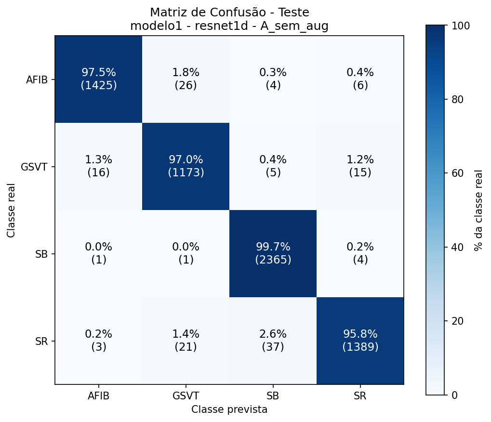
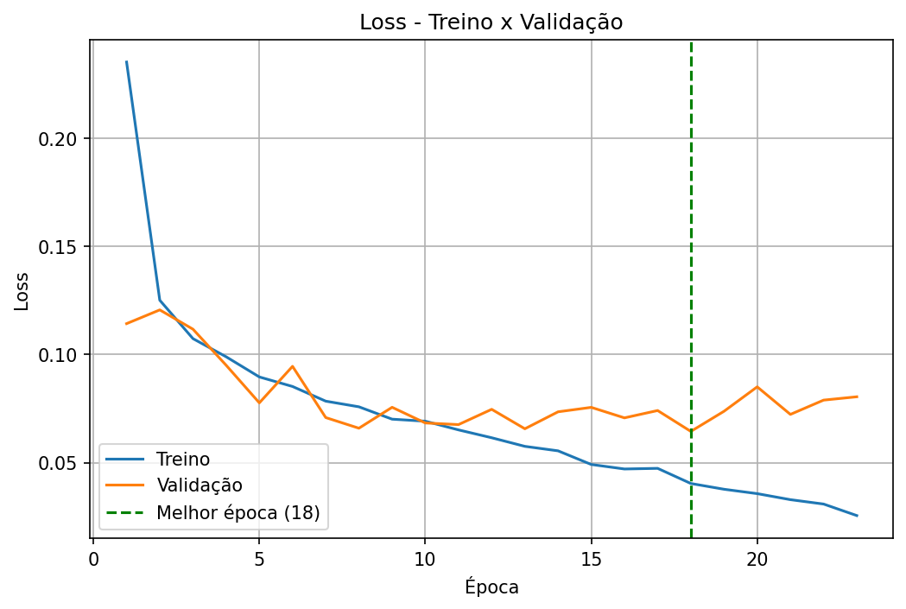
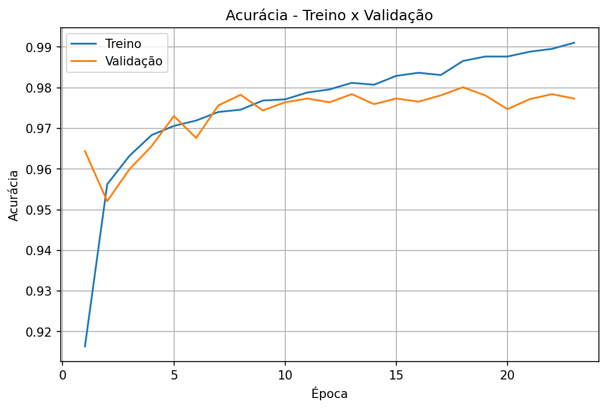

# Modelo 1: classificador geral (AFIB, GSVT, SB, SR)

Primeiro estágio da [cascata](../README.md). Classifica o ECG em 4 grupos de ritmo. Os grupos AFIB, GSVT e SR reúnem várias classes originais, que seriam refinadas pelos modelos 2, 3 e 4.

**Resultado: bom.** 97,86% de acurácia e F1 macro de 0,976 no teste.

## Tarefa

| Classe | Classes originais agrupadas |
|---|---|
| AFIB | AFIB, AF |
| GSVT | SVT, AT, AVRT, ST |
| SB | SB |
| SR | SR, SA |

## Dados

| Classe | Treino | Validação | Teste |
|---|---|---|---|
| AFIB | 6819 | 1464 | 1461 |
| GSVT | 5637 | 1206 | 1209 |
| SB | 11052 | 2370 | 2371 |
| SR | 6780 | 1452 | 1450 |
| **Total** | **30288** | **6492** | **6491** |

Sem augmentation e sem pesos de classe.

## Treino

ResNet1D com 4 saídas, treinada do zero (arquitetura e hiperparâmetros no [README geral](../README.md#configuração-de-treino)).

| | |
|---|---|
| Épocas executadas | 23 (early stopping) |
| Melhor época | 18 |
| Tempo | 58,5 min |
| Acurácia de treino (melhor época) | 98,66% |
| Loss de treino / validação (melhor época) | 0,0403 / 0,0644 |

## Resultados

### Resumo

| | Acurácia | F1 macro | F1 ponderado |
|---|---|---|---|
| Validação | 98,01% | 0,9776 | 0,9801 |
| **Teste** | **97,86%** | **0,9763** | **0,9785** |

### Por classe (teste)

| Classe | Precisão | Recall | F1 | Exames |
|---|---|---|---|---|
| AFIB | 0,9862 | 0,9754 | 0,9807 | 1461 |
| GSVT | 0,9607 | 0,9702 | 0,9654 | 1209 |
| SB | 0,9809 | 0,9975 | 0,9891 | 2371 |
| SR | 0,9823 | 0,9579 | 0,9700 | 1450 |

### Por classe (validação)

| Classe | Precisão | Recall | F1 | Exames |
|---|---|---|---|---|
| AFIB | 0,9834 | 0,9713 | 0,9773 | 1464 |
| GSVT | 0,9561 | 0,9760 | 0,9659 | 1206 |
| SB | 0,9871 | 0,9970 | 0,9920 | 2370 |
| SR | 0,9859 | 0,9649 | 0,9753 | 1452 |

### Matriz de confusão (teste)

Linhas = classe real, colunas = classe prevista. Contagem e % da classe real.

| Real \ Previsto | AFIB | GSVT | SB | SR |
|---|---|---|---|---|
| **AFIB** | 1425 (97,5%) | 26 (1,8%) | 4 (0,3%) | 6 (0,4%) |
| **GSVT** | 16 (1,3%) | 1173 (97,0%) | 5 (0,4%) | 15 (1,2%) |
| **SB** | 1 (0,0%) | 1 (0,0%) | 2365 (99,7%) | 4 (0,2%) |
| **SR** | 3 (0,2%) | 21 (1,4%) | 37 (2,6%) | 1389 (95,8%) |

### Matriz de confusão (validação)

| Real \ Previsto | AFIB | GSVT | SB | SR |
|---|---|---|---|---|
| **AFIB** | 1422 (97,1%) | 34 (2,3%) | 2 (0,1%) | 6 (0,4%) |
| **GSVT** | 18 (1,5%) | 1177 (97,6%) | 1 (0,1%) | 10 (0,8%) |
| **SB** | 3 (0,1%) | 0 (0,0%) | 2363 (99,7%) | 4 (0,2%) |
| **SR** | 3 (0,2%) | 20 (1,4%) | 28 (1,9%) | 1401 (96,5%) |

## Curvas de treino

## Análise

- **Desempenho consistente entre validação e teste** (98,0% e 97,9%), o que indica que a seleção da melhor época não superajustou a validação.
- **Overfitting leve.** A loss de treino continua caindo até a época 23, enquanto a de validação fica estável em torno de 0,07 a partir da época 8. A diferença de acurácia entre treino e validação na melhor época é pequena (98,7% contra 98,0%).
- **SB é a classe mais fácil** (recall de 99,7%).
- **Principais confusões no teste:**
  - AFIB ↔ GSVT: 26 AFIB previstos como GSVT e 16 GSVT previstos como AFIB (42 no total). Esses erros fazem o exame seguir para o especialista errado na cascata.
  - SR → SB: 37 exames, o maior erro isolado.
  - SR → GSVT: 21 exames.
- O grupo SR é o de menor recall (95,8%).

## Limitações

- Uma única execução (semente 42), sem média entre execuções.
- Sem augmentation e sem pesos de classe; os grupos estão relativamente equilibrados, então o impacto esperado é menor que nos especialistas.
- O desempenho por classe original dentro de cada grupo não é medido aqui; isso depende dos modelos 2, 3 e 4.

## Arquivos gerados

`sinais_ecg_4c_modelo1_resnet1d_A_sem_aug`: `.json` (métricas e histórico), `.pt` (pesos), `_loss.png`, `_acuracia.png`, `_matriz_validacao.png`, `_matriz_teste.png`.
