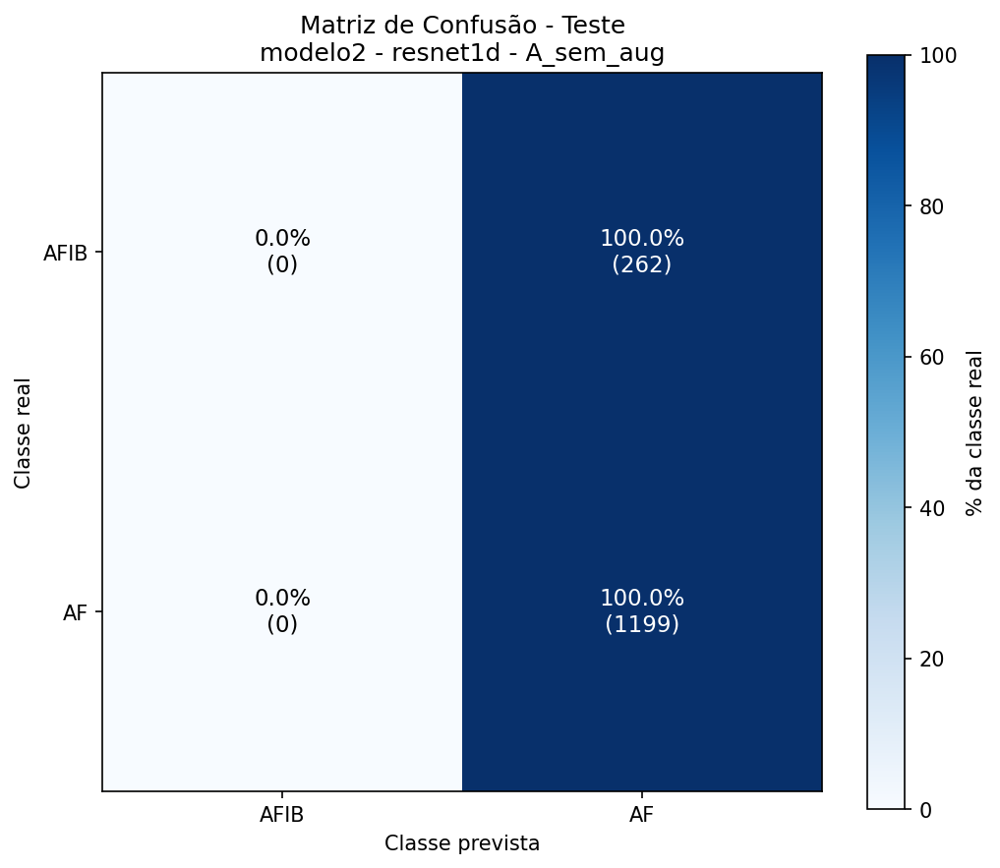
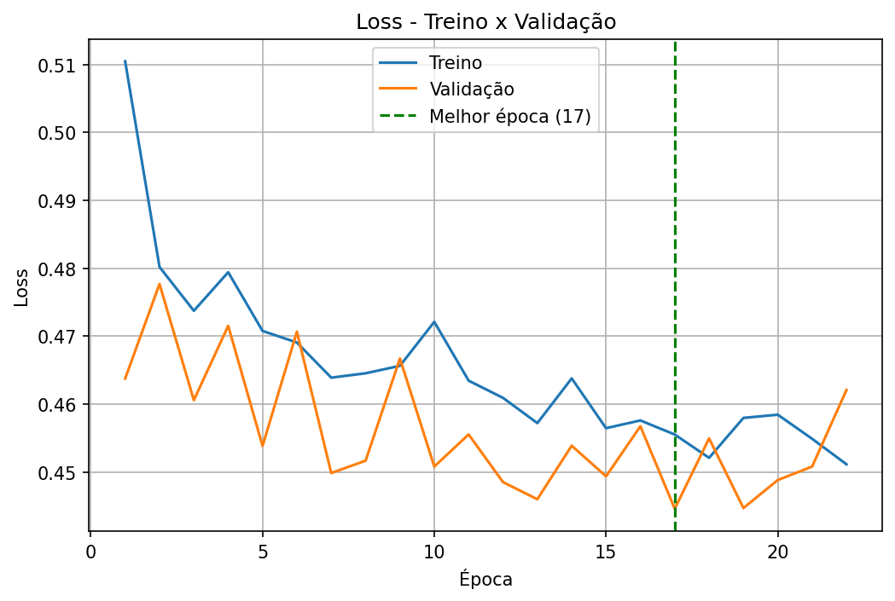
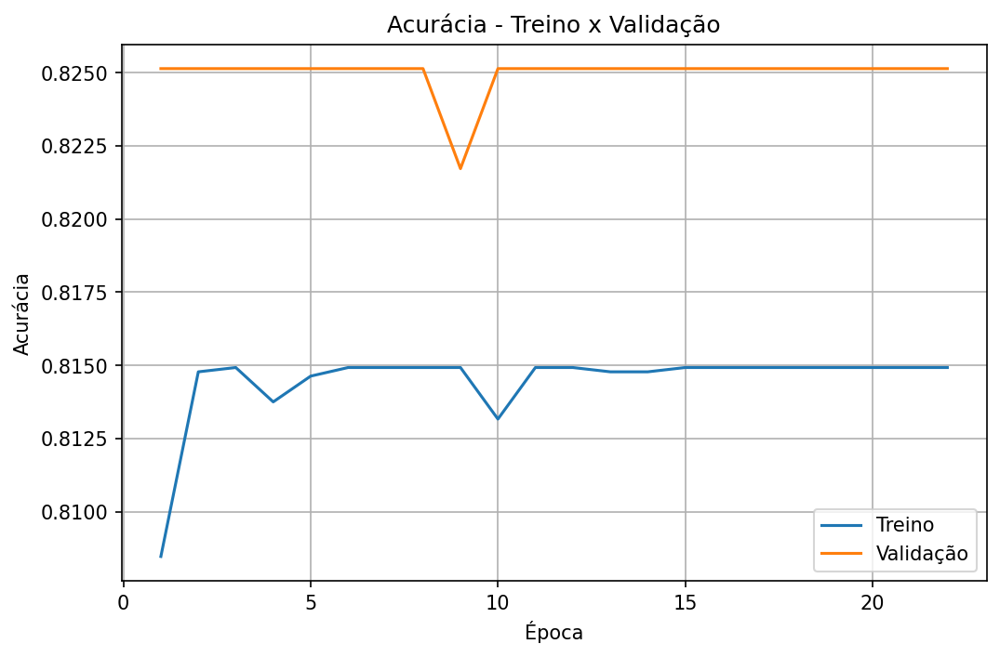

# Modelo 2: especialista do grupo AFIB (AFIB × AF)

Segundo estágio da [cascata](../README.md). Deveria distinguir fibrilação atrial (AFIB) de flutter atrial (AF) nos exames que o [modelo 1](../modelo1/README.md) classifica como AFIB.

**Resultado: o modelo não aprendeu a tarefa.** Ele prevê AF para todos os exames, e a acurácia é igual à de um classificador que sempre responde a classe majoritária. Não deve ser usado na cascata como está.

## Tarefa

Classificação binária, usando só os exames das classes AFIB e AF.

## Dados

| Classe | Treino | Validação | Teste |
|---|---|---|---|
| AFIB | 1262 | 256 | 262 |
| AF | 5557 | 1208 | 1199 |
| **Total** | **6819** | **1464** | **1461** |

Desbalanceamento de cerca de 4,4 para 1 (AF é 81,5% do treino). Sem augmentation e sem pesos de classe.

## Treino

ResNet1D com 2 saídas, treinada do zero (hiperparâmetros no [README geral](../README.md#configuração-de-treino)).

| | |
|---|---|
| Épocas executadas | 22 (early stopping) |
| Melhor época | 17 |
| Tempo | 10,8 min |
| Acurácia de treino (melhor época) | 81,49% |
| Loss de treino / validação (melhor época) | 0,4555 / 0,4446 |

## Resultados

### Resumo

| | Acurácia | F1 macro | F1 ponderado | Baseline (sempre AF) |
|---|---|---|---|---|
| Validação | 82,51% | 0,4521 | 0,7461 | 82,51% |
| Teste | 82,07% | 0,4508 | 0,7398 | 82,07% |

### Por classe (teste)

| Classe | Precisão | Recall | F1 | Exames |
|---|---|---|---|---|
| AFIB | 0,0000 | 0,0000 | 0,0000 | 262 |
| AF | 0,8207 | 1,0000 | 0,9015 | 1199 |

### Por classe (validação)

| Classe | Precisão | Recall | F1 | Exames |
|---|---|---|---|---|
| AFIB | 0,0000 | 0,0000 | 0,0000 | 256 |
| AF | 0,8251 | 1,0000 | 0,9042 | 1208 |

### Matriz de confusão (teste)

| Real \ Previsto | AFIB | AF |
|---|---|---|
| **AFIB** | 0 (0,0%) | 262 (100,0%) |
| **AF** | 0 (0,0%) | 1199 (100,0%) |

### Matriz de confusão (validação)

| Real \ Previsto | AFIB | AF |
|---|---|---|
| **AFIB** | 0 (0,0%) | 256 (100,0%) |
| **AF** | 0 (0,0%) | 1208 (100,0%) |

## Curvas de treino

## Análise

- **Colapso para a classe majoritária.** A acurácia de treino (81,49%) é exatamente a proporção de AF no treino (5557 de 6819), e a de validação (82,51%) é a proporção de AF na validação. A acurácia fica praticamente parada em todas as épocas.
- A loss de validação oscila entre 0,445 e 0,478 sem tendência clara de queda. A "melhor época" (17) é escolhida entre valores muito próximos e não representa uma melhora real.
- O F1 macro de 0,45 reflete o F1 zero de AFIB; a acurácia de 82% é enganosa nesse contexto.
- Como o modelo 1 separa o grupo AFIB dos demais com ~97,5% de recall, a dificuldade parece estar especificamente em distinguir AFIB de AF com esta configuração, e não em reconhecer o grupo.

## Hipóteses e próximos passos

Nenhuma das hipóteses abaixo foi testada ainda:

1. **Desbalanceamento sem tratamento:** usar pesos de classe na perda, `WeightedRandomSampler` ou subamostragem da classe AF.
2. **Early stopping inadequado:** com a loss de validação quase plana, a paciência de 5 pode encerrar o treino antes de a rede sair do mínimo trivial; testar paciência maior e/ou outro learning rate (por exemplo 1e-4) com scheduler.
3. **Qualidade dos rótulos:** AFIB e AF podem coexistir ou ser difíceis de rotular; revisar uma amostra dos exames e checar duplicatas entre treino e teste.
4. **Métricas mais adequadas:** acompanhar recall por classe, balanced accuracy e AUC, que não são enganadas pelo desbalanceamento.

## Arquivos gerados

`sinais_ecg_4c_modelo2_resnet1d_A_sem_aug`: `.json` (métricas e histórico), `.pt` (pesos), `_loss.png`, `_acuracia.png`, `_matriz_validacao.png`, `_matriz_teste.png`.
