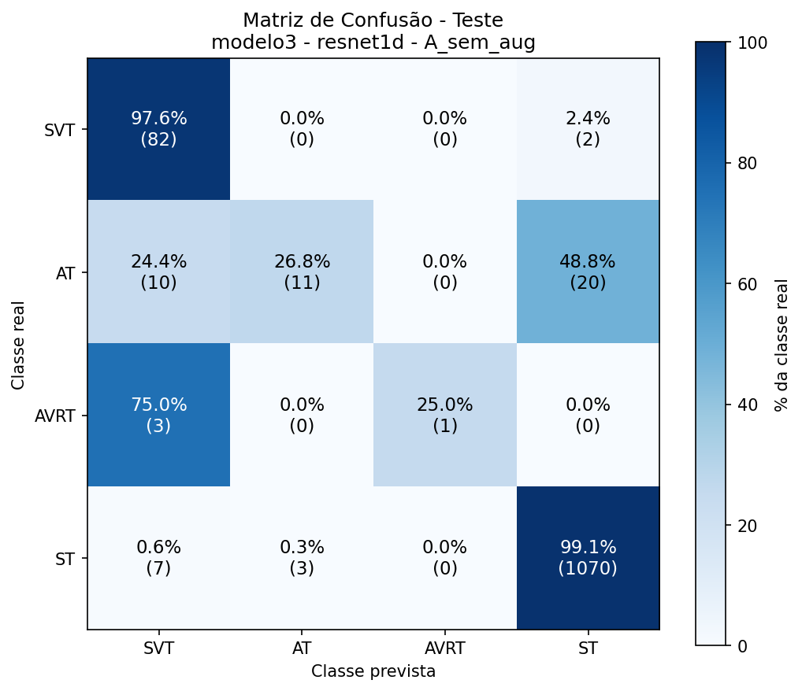
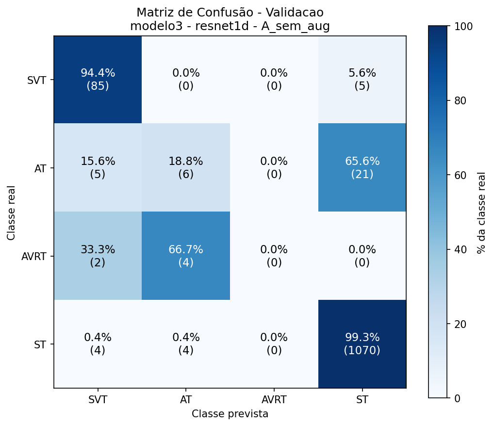
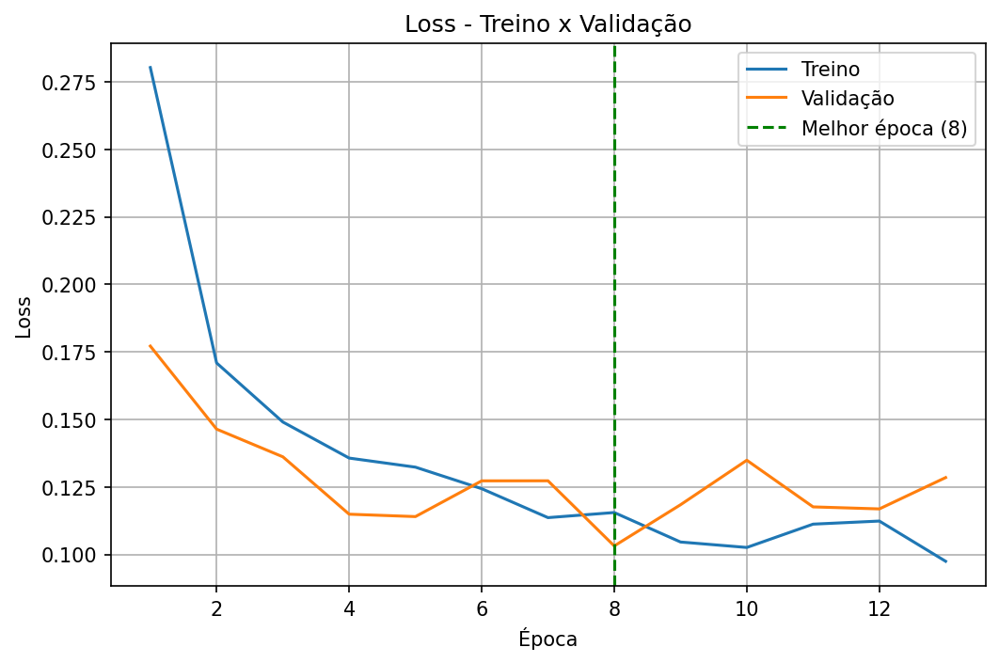
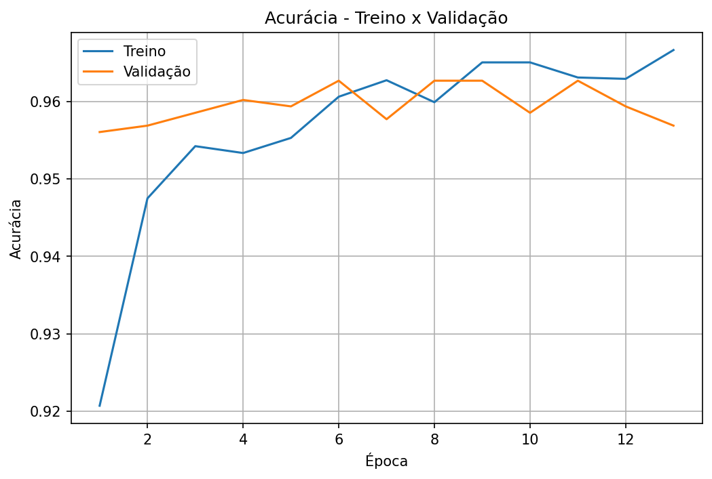

# Modelo 3: especialista do grupo GSVT (SVT, AT, AVRT, ST)

Terceiro estágio da [cascata](../README.md). Distingue as quatro classes originais do grupo GSVT nos exames que o [modelo 1](../modelo1/README.md) classifica como GSVT.

**Resultado: parcial.** Bom para SVT e ST, fraco para AT e AVRT, que têm poucos exemplos. A acurácia geral (96,3%) é dominada pela classe ST.

## Tarefa

Classificação em 4 classes, usando só os exames de SVT, AT, AVRT e ST.

## Dados

| Classe | Treino | Validação | Teste |
|---|---|---|---|
| SVT | 486 | 90 | 84 |
| AT | 177 | 32 | 41 |
| AVRT | 14 | 6 | 4 |
| ST | 4960 | 1078 | 1080 |
| **Total** | **5637** | **1206** | **1209** |

Desbalanceamento extremo: ST é 88% do treino e AVRT tem apenas 14 exames. Sem augmentation e sem pesos de classe.

## Treino

ResNet1D com 4 saídas, treinada do zero (hiperparâmetros no [README geral](../README.md#configuração-de-treino)).

| | |
|---|---|
| Épocas executadas | 13 (early stopping) |
| Melhor época | 8 |
| Tempo | 5,7 min |
| Acurácia de treino (melhor época) | 95,99% |
| Loss de treino / validação (melhor época) | 0,1155 / 0,1031 |

## Resultados

### Resumo

| | Acurácia | F1 macro | F1 ponderado |
|---|---|---|---|
| Validação | 96,27% | 0,5398 | 0,9550 |
| Teste | 96,28% | 0,6667 | 0,9563 |

Baseline (sempre ST): 89,3% no teste e 89,4% na validação.

### Por classe (teste)

| Classe | Precisão | Recall | F1 | Exames |
|---|---|---|---|---|
| SVT | 0,8039 | 0,9762 | 0,8817 | 84 |
| AT | 0,7857 | 0,2683 | 0,4000 | 41 |
| AVRT | 1,0000 | 0,2500 | 0,4000 | 4 |
| ST | 0,9799 | 0,9907 | 0,9853 | 1080 |

### Por classe (validação)

| Classe | Precisão | Recall | F1 | Exames |
|---|---|---|---|---|
| SVT | 0,8854 | 0,9444 | 0,9140 | 90 |
| AT | 0,4286 | 0,1875 | 0,2609 | 32 |
| AVRT | 0,0000 | 0,0000 | 0,0000 | 6 |
| ST | 0,9763 | 0,9926 | 0,9844 | 1078 |

### Matriz de confusão (teste)

| Real \ Previsto | SVT | AT | AVRT | ST |
|---|---|---|---|---|
| **SVT** | 82 (97,6%) | 0 (0,0%) | 0 (0,0%) | 2 (2,4%) |
| **AT** | 10 (24,4%) | 11 (26,8%) | 0 (0,0%) | 20 (48,8%) |
| **AVRT** | 3 (75,0%) | 0 (0,0%) | 1 (25,0%) | 0 (0,0%) |
| **ST** | 7 (0,6%) | 3 (0,3%) | 0 (0,0%) | 1070 (99,1%) |

### Matriz de confusão (validação)

| Real \ Previsto | SVT | AT | AVRT | ST |
|---|---|---|---|---|
| **SVT** | 85 (94,4%) | 0 (0,0%) | 0 (0,0%) | 5 (5,6%) |
| **AT** | 5 (15,6%) | 6 (18,8%) | 0 (0,0%) | 21 (65,6%) |
| **AVRT** | 2 (33,3%) | 4 (66,7%) | 0 (0,0%) | 0 (0,0%) |
| **ST** | 4 (0,4%) | 4 (0,4%) | 0 (0,0%) | 1070 (99,3%) |

## Curvas de treino

## Análise

- **A acurácia de 96,3% engana.** ST representa 89% do teste; sozinho, um classificador que sempre responde ST acertaria 89,3%. O F1 macro (0,67 no teste, 0,54 na validação) mostra melhor o desempenho real.
- **SVT e ST estão bem resolvidos** (recall de 97,6% e 99,1% no teste).
- **AT é a classe mais problemática entre as que têm exemplos suficientes:** recall de 26,8% no teste, com 48,8% dos AT classificados como ST e 24,4% como SVT. Na validação o recall é 18,8%.
- **AVRT não pode ser avaliado com confiança.** São 14 exemplos de treino, 6 de validação e 4 de teste. O recall de 25% no teste corresponde a 1 acerto em 4 exames, e na validação foram 0 de 6. A diferença de F1 macro entre validação e teste vem em grande parte dessa classe.
- O treino parou cedo (melhor época 8) e a acurácia de validação ficou estável em ~96%, sem sinais de que mais épocas resolveriam o problema.

## Hipóteses e próximos passos

Nenhuma das hipóteses abaixo foi testada ainda:

1. **Pesos de classe ou amostragem balanceada** para AT e AVRT.
2. **Augmentation** (ruído, deslocamento, escala de amplitude) aplicada só às classes minoritárias.
3. **Mais dados de AVRT.** Com 14 exemplos, uma rede com milhões de parâmetros dificilmente generaliza; considerar fundir AVRT com outra classe ou tratá-la como "outras taquicardias supraventriculares".
4. **Avaliar com métricas por classe e intervalo de confiança**, dado o tamanho dos conjuntos de AT e AVRT.

## Arquivos gerados

`sinais_ecg_4c_modelo3_resnet1d_A_sem_aug`: `.json` (métricas e histórico), `.pt` (pesos), `_loss.png`, `_acuracia.png`, `_matriz_validacao.png`, `_matriz_teste.png`.
