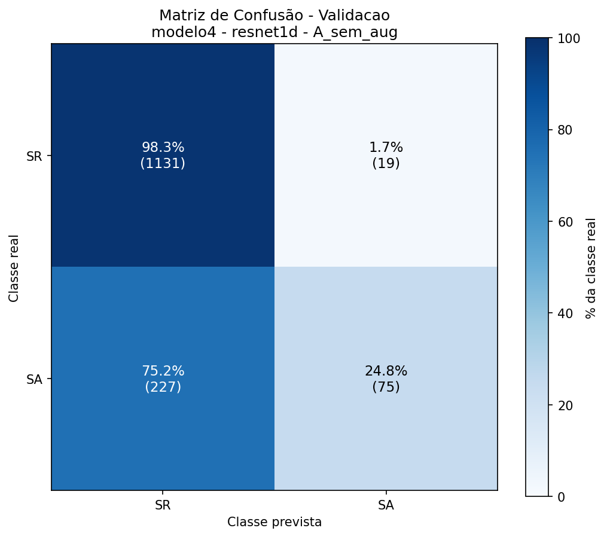
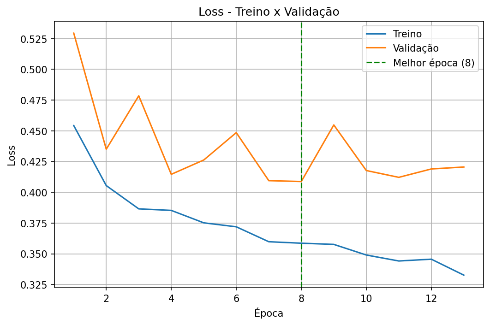
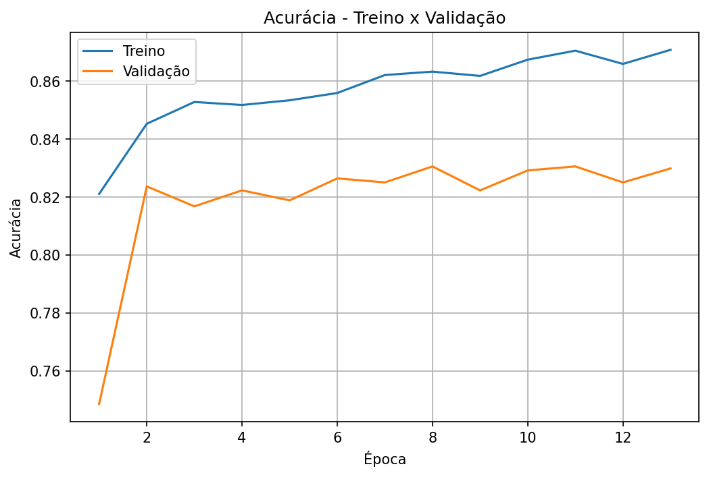

# Modelo 4: especialista do grupo SR (SR × SA)

Quarto estágio da [cascata](../README.md). No agrupamento usado pelo [modelo 1](../modelo1/README.md), o SA pertence ao grupo SR; este modelo distingue SR de SA nos exames classificados como SR.

**Resultado: parcial.** Reconhece bem SR (recall de 98,4%), mas detecta só 28,4% dos SA. A acurácia fica pouco acima do baseline.

## Tarefa

Classificação binária, usando só os exames das classes SR e SA.

## Dados

| Classe | Treino | Validação | Teste |
|---|---|---|---|
| SR | 5536 | 1150 | 1186 |
| SA | 1244 | 302 | 264 |
| **Total** | **6780** | **1452** | **1450** |

Desbalanceamento de cerca de 4,5 para 1 (SR é 81,7% do treino). Sem augmentation e sem pesos de classe.

## Treino

ResNet1D com 2 saídas, treinada do zero (hiperparâmetros no [README geral](../README.md#configuração-de-treino)).

| | |
|---|---|
| Épocas executadas | 13 (early stopping) |
| Melhor época | 8 |
| Tempo | 7,0 min |
| Acurácia de treino (melhor época) | 86,33% |
| Loss de treino / validação (melhor época) | 0,3586 / 0,4088 |

## Resultados

### Resumo

| | Acurácia | F1 macro | F1 ponderado | Baseline (sempre SR) |
|---|---|---|---|---|
| Validação | 83,06% | 0,6404 | 0,7931 | 79,2% |
| Teste | 85,66% | 0,6686 | 0,8273 | 81,8% |

### Por classe (teste)

| Classe | Precisão | Recall | F1 | Exames |
|---|---|---|---|---|
| SR | 0,8606 | 0,9840 | 0,9182 | 1186 |
| SA | 0,7979 | 0,2841 | 0,4190 | 264 |

### Por classe (validação)

| Classe | Precisão | Recall | F1 | Exames |
|---|---|---|---|---|
| SR | 0,8328 | 0,9835 | 0,9019 | 1150 |
| SA | 0,7979 | 0,2483 | 0,3788 | 302 |

### Matriz de confusão (teste)

| Real \ Previsto | SR | SA |
|---|---|---|
| **SR** | 1167 (98,4%) | 19 (1,6%) |
| **SA** | 189 (71,6%) | 75 (28,4%) |

### Matriz de confusão (validação)

| Real \ Previsto | SR | SA |
|---|---|---|
| **SR** | 1131 (98,3%) | 19 (1,7%) |
| **SA** | 227 (75,2%) | 75 (24,8%) |

## Curvas de treino

## Análise

- **Aprendeu algo, mas pouco.** A acurácia (85,7% no teste, 83,1% na validação) supera o baseline de sempre responder SR (81,8% e 79,2%), diferente do modelo 2, mas por margem pequena.
- **Viés para SR.** 71,6% dos SA são classificados como SR no teste (75,2% na validação). Quando o modelo diz SA, acerta 79,8% das vezes (precisão), mas encontra só uma fração dos SA (recall de 28,4%).
- **Gap entre treino e validação:** 86,3% contra 83,1% de acurácia na melhor época, e a loss de validação oscila (0,41 a 0,45) sem melhora clara depois da época 8.
- O número de exames SA (264 no teste, 302 na validação) é razoável, então as métricas por classe são mais confiáveis que as do modelo 3, mas ainda são uma única execução.

## Hipóteses e próximos passos

Nenhuma das hipóteses abaixo foi testada ainda:

1. **Pesos de classe ou amostragem balanceada** para aumentar o recall de SA.
2. **Ajustar o limiar de decisão** (em vez do argmax), escolhendo-o na validação conforme o equilíbrio desejado entre precisão e recall de SA.
3. **Augmentation** e/ou treino mais longo com learning rate menor.
4. **Verificar se SR × SA é separável** no sinal de 10 s (por exemplo, olhando exemplos de SA classificados como SR), já que o modelo 1 também confunde SR com outras classes.

## Arquivos gerados

`sinais_ecg_4c_modelo4_resnet1d_A_sem_aug`: `.json` (métricas e histórico), `.pt` (pesos), `_loss.png`, `_acuracia.png`, `_matriz_validacao.png`, `_matriz_teste.png`.
